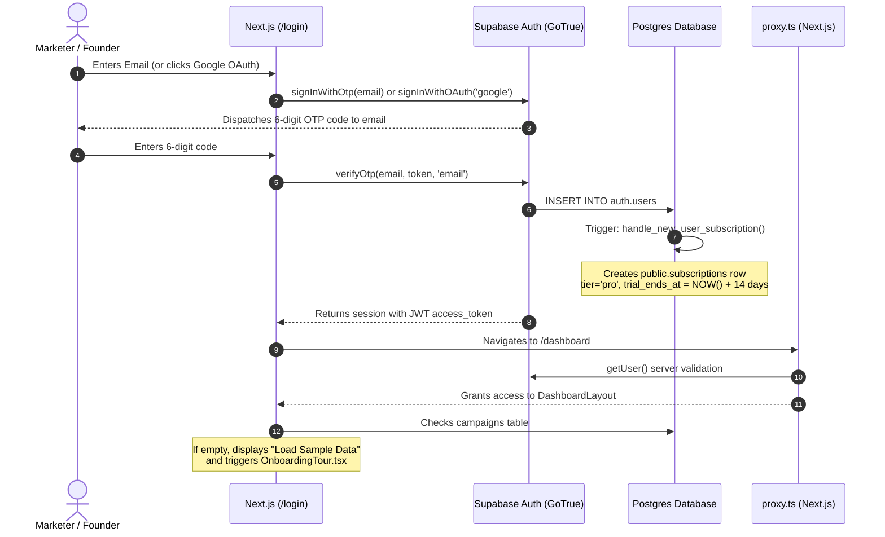
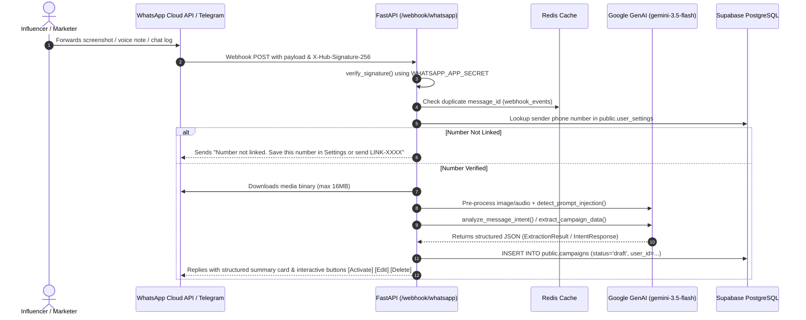
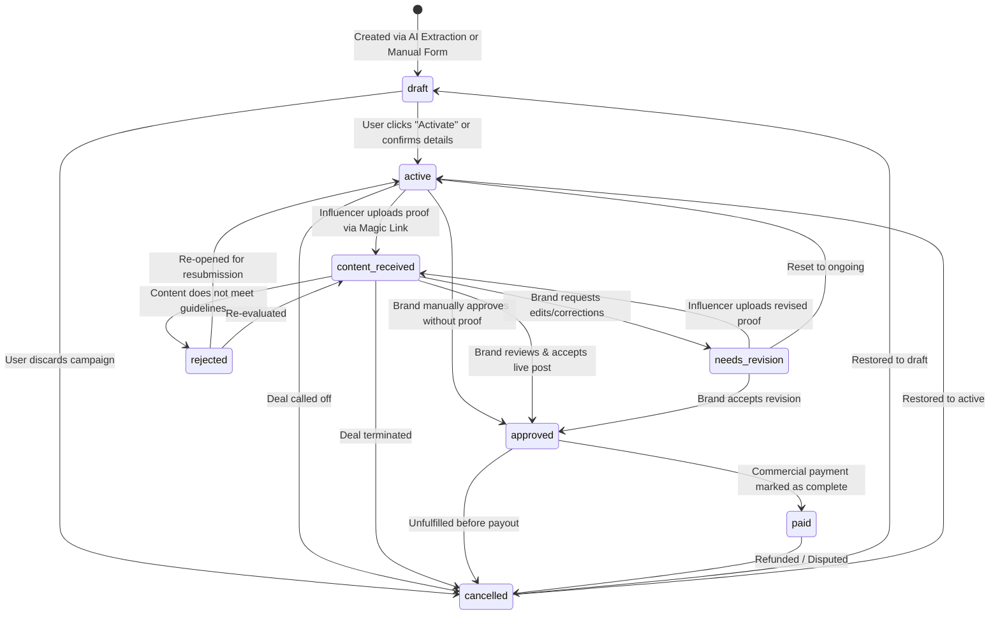

# COLLABO (mycollabo.online) — Comprehensive Architectural Context & Technical Specification

> **Document Purpose:** This file serves as the definitive, single-source-of-truth architectural and implementation blueprint for **Collabo** (`mycollabo.online`). It contains exhaustive specifications of the application architecture, database schema, API contracts, AI pipelines, UI/UX structure, and end-to-end business workflows. It is authored with sufficient depth to allow any engineer or AI assistant to understand, maintain, debug, and extend the system without raw repository access.

---

## 1. Project Overview & Tech Stack

### 1.1 Core Purpose & Value Proposition
Collabo is a specialized B2B SaaS operating system built for Indian Direct-to-Consumer (D2C) brands, e-commerce marketers, and influencer talent agencies. 
Managing hundreds of micro-influencers typically results in operational collapse due to scattered WhatsApp/Telegram chats, lost DM screenshots, forgotten deadlines, manual spreadsheet updates, and delayed deliverable proofs.

**Collabo automates the entire campaign lifecycle:**
1. **Zero-Entry Ingestion:** Marketers forward WhatsApp voice notes, DM negotiation screenshots, contracts, or text briefs directly to the Collabo Bot (or upload them via the web UI).
2. **Multimodal AI Extraction:** Google Gemini analyzes the unstructured conversations/media, extracting creators, handles, deliverables, agreed commercial rates (INR), deadlines, and instructions into clean structured drafts.
3. **Automated Reminders:** Background cron schedulers continuously monitor upcoming deadlines and overdue milestones, dispatching automated WhatsApp and email reminders to creators and brands.
4. **Frictionless Proof Submission (Magic Links):** Influencers do not need to register or download an app. They receive unique "Magic Links" (`/submit-proof/[token]`) where they upload live content links or screenshots/videos directly into secure storage.
5. **Creator CRM & Analytics:** Aggregates creator collaboration history, reliability/success rates, click tracking, and overall campaign ROI metrics.

---

### 1.2 Frontend Stack
* **Framework:** Next.js 16.2.9 (App Router, Server Components + Client Components)
* **Language & Core:** TypeScript 5, React 19.2.4, React DOM 19.2.4
* **Styling & Design System:**
  * Tailwind CSS v4 (`@tailwindcss/postcss`, Tailwind 4 modern CSS-first configuration)
  * Dark/Light Mode: `next-themes` (v0.4.6) with class-based hydration and glassmorphism styling
  * Color Palette: Slate dark background (`#020617`, `#030712`, `#0f172a`), emerald primary accents (`#10b981`, `#00D4A5`, `#00FFC8`), and state badges (Amber, Rose, Blue, Purple)
  * Icons: `lucide-react` (v1.17.0)
* **State Management & Data Fetching:**
  * Client HTTP: `axios` (v1.17.0) with centralized JWT injection and 401 refresh interceptors
  * Context API: `CampaignModalContext.tsx` for global create/edit modal controls
  * Local Storage & State Hooks: React `useState`, `useCallback`, `useMemo`, `useRef`
* **UI Utilities & Components:**
  * Toast Notifications: `sonner` (v2.0.7)
  * User Onboarding: `react-joyride` (v3.1.0) & custom Framer Motion walkthrough (`OnboardingTour.tsx`)
  * Image Processing / Canvas: `jimp` (v1.6.1)
  * Charts: `recharts` dynamically imported with `ssr: false` in `AnalyticsChart.tsx`
* **Edge & Proxy:**
  * Next.js 16 `proxy.ts` (renamed from `middleware.ts`) handling server-side route protection and authentication redirects via `@supabase/ssr`

---

### 1.3 Backend Stack & Infrastructure Services
* **Runtime & Framework:** Python 3.10+, FastAPI (>= 0.110.0), ASGI Server: Uvicorn (>= 0.29.0)
* **Database & BaaS:** Supabase PostgreSQL with PostgREST, GoTrue Auth, and Supabase Storage
* **Data Validation & Serializers:** Pydantic v2 (>= 2.6.0) with `ConfigDict`, `field_validator`, and `pydantic-settings` (>= 2.2.0)
* **Background Jobs & Scheduling:** APScheduler 3.x (`AsyncIOScheduler`, `AsyncIOExecutor`) with Redis distributed locks
* **Rate Limiting & Security:** `slowapi` (>= 0.1.9) with IP spoofing guards (`X-Forwarded-For`), HTTP security headers (HSTS, CSP, X-Frame-Options, X-Content-Type-Options)
* **Logging & Observability:**
  * `structlog` (>= 24.0.0) configuring JSON logs in production with secret redactor processors
  * Sentry SDK (>= 2.0.0) with FastAPI performance and error tracing
* **Caching & Distributed Locks:** `redis` (>= 5.0.0) for pairing code storage, deduplication, and cron locks
* **Document & Media Parsers:**
  * Image: `pillow` (>= 10.2.0), `pillow-heif` (>= 0.16.0) for Apple HEIC photos
  * Documents: `pypdf` (>= 5.1.0), `python-docx` (>= 1.1.0)
  * MIME Detection: `python-magic` (>= 0.4.27)
* **Report Generation:** `reportlab` (>= 4.1.0) for PDF reports, `openpyxl` (>= 3.1.2) for Excel workbooks
* **Payments & Billing:** `razorpay` (>= 1.4.1) for INR payment orders, signature verification, and webhooks

---

### 1.4 AI / LLM & Messaging Integrations
* **SDK:** Google GenAI SDK (`google-genai` >= 1.0.0)
* **Models:**
  * Primary: `gemini-3.5-flash`
  * Fallback: `gemini-2.5-flash`
* **Structured Output:** Strictly enforced JSON output schemas via Pydantic (`ExtractionResult`, `IntentResponse`) with temperature `0.1`
* **Multimodal Pipelines:** In-memory compression (max 1600x1600, iterative JPEG reduction < 500KB), multi-page PDF image/text extraction, audio voice note parsing directly into Gemini
* **Prompt Protection:** Multi-layer prompt injection detection with regex, token density scoring, and invisible Unicode zero-width character stripping
* **WhatsApp Integration:**
  * Meta Cloud API via Graph API endpoints (`https://graph.facebook.com/v19.0/{PHONE_NUMBER_ID}/messages`)
  * Webhook receiver with HMAC-SHA256 signature verification (`X-Hub-Signature-256`)
  * Interactive components: Button replies (`activate_{id}`, `edit_{id}`, `delete_{id}`) and List messages
  * Pairing system: `LINK-XXXX` codes cached in Redis for 10 minutes
* **Telegram Integration:**
  * Telegram Bot API (`https://api.telegram.org/bot{TOKEN}/...`)
  * Support for text, photos, documents, and voice notes (`getFile` with 16MB stream limit)
  * Inline keyboard buttons and callback query answering

---

### 1.5 Deployment & Infrastructure
* **Frontend:** Deployed on **Vercel** (`https://mycollabo.online`). Connected to GitHub repository `shahulhameed-csecore/Collabo-2`.
* **Backend:** Deployed on **Render** as a Python Web Service (`https://collabo-2.onrender.com` / `https://api.mycollabo.online`) executing `uvicorn app.main:app --host 0.0.0.0 --port 10000`.
* **Database & Storage:** Hosted on **Supabase** (PostgreSQL 15+, S3-compatible Storage bucket `proof-uploads`).
* **Deploy Automation:**
  * `push-frontend.ps1`: Syncs `influencertrack-frontend/` to `influencertrack-backend/frontend/`, commits and pushes to trigger Vercel deployment.
  * `push-backend.ps1`: Stages backend files (`app`, `requirements.txt`, `render.yaml`), commits and pushes to trigger Render redeployment.
  * `push-vercel.ps1`: Synchronizes frontend assets and verifies staging against git diffs.

#### Required Environment Variable Keys (No Secrets Included)
##### Frontend (`.env.local`)
* `NEXT_PUBLIC_SUPABASE_URL`: Supabase project URL (`https://<id>.supabase.co`)
* `NEXT_PUBLIC_SUPABASE_ANON_KEY`: Supabase anonymous public API key
* `NEXT_PUBLIC_API_URL`: URL of the FastAPI backend (`https://collabo-2.onrender.com`)
* `NEXT_PUBLIC_BOT_NUMBER`: WhatsApp bot display number (`+91XXXXXXXXXX`)
* `NEXT_PUBLIC_TELEGRAM_BOT_USERNAME`: Telegram bot handle (`@collabo_bot`)
* `NEXT_PUBLIC_RAZORPAY_KEY_ID`: Razorpay key ID for frontend checkout modal

##### Backend (`render.yaml` / `.env`)
* `ENVIRONMENT`: `production` or `development`
* `BASE_URL`: Base URL for links (`https://mycollabo.online`)
* `ALLOWED_ORIGINS`: Comma-separated CORS origins (`https://mycollabo.online,http://localhost:3000`)
* `SUPABASE_URL`: Supabase project URL
* `SUPABASE_ANON_KEY`: Supabase anon key
* `SUPABASE_SERVICE_ROLE_KEY`: Supabase master key (bypasses RLS for backend cron/admin tasks)
* `GEMINI_API_KEY`: Primary Google Gemini API key
* `GEMINI_API_KEY_1`: Google Gemini API key (primary slot)
* `GEMINI_API_KEY_2`: Google Gemini API key (secondary failover slot)
* `WHATSAPP_TOKEN`: Meta Graph API permanent access token
* `WHATSAPP_PHONE_NUMBER_ID`: Meta Cloud API phone number identifier
* `WHATSAPP_WEBHOOK_VERIFY_TOKEN`: Verification token matching Meta webhook config
* `WHATSAPP_APP_SECRET`: Meta App Secret for HMAC-SHA256 signature verification
* `TELEGRAM_BOT_TOKEN`: Telegram Bot token from BotFather
* `TELEGRAM_WEBHOOK_SECRET`: Secret token for Telegram webhook validation
* `GMAIL_WEBHOOK_URL`: Transactional email webhook endpoint (Google Apps Script)
* `GMAIL_WEBHOOK_SECRET`: Secret token for email webhook authentication
* `RESEND_API_KEY`: Resend API key (fallback email provider)
* `RAZORPAY_KEY_ID`: Razorpay key ID
* `RAZORPAY_KEY_SECRET`: Razorpay key secret
* `RAZORPAY_WEBHOOK_SECRET`: Razorpay webhook secret for signature verification
* `PRO_MONTHLY_INR`: Pricing for monthly plan in INR (default `300`)
* `PRO_ANNUAL_INR`: Pricing for annual plan in INR (default `3000`)
* `REDIS_URL`: Redis connection URI (`redis://...`)
* `SCHEDULER_INTERVAL_MINUTES`: Frequency of deadline checker cron (default `60`)
* `INTERNAL_SECRET`: Secret header key for debugging `POST /internal/trigger-reminders`
* `SENTRY_DSN`: Sentry DSN for error monitoring
* `LOG_LEVEL`: Logging verbosity (`INFO`, `DEBUG`, `WARNING`)

---

## 2. Complete Directory & File Tree

```text
collabo-part-2/
├── AGENTS.md                                # Workspace development rules and Next.js 16 conventions
├── DOCUMENTATION.md                         # Product requirements and executive documentation
├── IMPLEMENTED_FIXES.md                     # History of resolved bugs and performance remediations
├── CUSTOMER_READY_REMEDIATION_REPORT.md    # Security audit and launch readiness audit report
├── security_audit_report.md                 # Detailed security penetration testing and audit findings
├── features of Collabo.md                   # Feature overview and zero-trust security summary
├── package.json                             # Root frontend package definition (Next.js 16, React 19)
├── tsconfig.json                            # TypeScript configuration with path aliases (@/*)
├── next.config.ts                           # Next.js configuration (images, experimental flags)
├── postcss.config.mjs                       # PostCSS configuration for Tailwind CSS v4
├── proxy.ts                                 # Next.js 16 Edge proxy (server-side auth guards and redirects)
├── push-frontend.ps1                        # PowerShell sync script: copies frontend source to backend repo
├── push-backend.ps1                         # PowerShell script: commits and deploys FastAPI backend to Render
├── push-vercel.ps1                          # PowerShell script: deploys frontend changes to Vercel
│
├── supabase_migrations/                     # Production SQL migrations and database schema definitions
│   ├── 01_subscriptions.sql                # Subscriptions table & 14-day Pro trial signup trigger
│   ├── 02_phase2_schema.sql                # Influencer profiles table & AI extraction count function
│   ├── 03_add_username.sql                 # Adds unique username column to user_settings
│   ├── 04_auth_helpers.sql                 # get_email_by_username SECURITY DEFINER function
│   ├── 05_security_and_rls.sql             # Strict Row Level Security policies for campaigns & settings
│   ├── 06_reminders_schema.sql             # reminder_48h_sent and overdue_alert_sent flag columns
│   ├── 08_add_rejected_status.sql          # Adds 'rejected' status to campaign_status enum
│   ├── 10_security_audit.sql               # Forces RLS on all tables and locks down proof-uploads bucket
│   ├── 12_notifications_grants.sql         # Permissions and grants for notifications table
│   ├── 12_update_existing_trials.sql       # Data migration updating active trial timestamps
│   ├── 13_add_campaign_indexes.sql         # B-tree performance indexes on campaigns table
│   ├── 14_webhook_cleanup.sql              # Deduplication cleanup and webhook index guards
│   ├── 15_add_is_paid_to_subscriptions.sql # Adds is_paid boolean flag to subscriptions table
│   └── 16_force_update_specific_account.sql# Utility script for manual account status maintenance
│
├── influencertrack-frontend/                # Master Next.js frontend application source
│   ├── app/                                 # Next.js App Router root
│   │   ├── (dashboard)/                     # Authenticated dashboard route group
│   │   │   ├── layout.tsx                   # Sub-layout wrapping dashboard pages with navigation
│   │   │   ├── dashboard/                   # Main campaign tracking view
│   │   │   │   ├── page.tsx                 # Core dashboard: metrics, top deadlines, campaign table
│   │   │   │   ├── layout.tsx               # Dashboard specific sub-layout
│   │   │   │   └── analytics/               # ROI & spending analytics
│   │   │   │       └── page.tsx             # Performance graphs, click stats, platform breakdowns
│   │   │   ├── influencers/                 # Creator CRM directory
│   │   │   │   └── page.tsx                 # Influencer table, collaboration history, editable notes
│   │   │   ├── billing/                     # Plan and payment administration
│   │   │   │   └── page.tsx                 # Usage meters, Razorpay upgrade modal, billing info
│   │   │   └── settings/                    # Integration & reminder configuration
│   │   │       ├── page.tsx                 # WhatsApp/Telegram pairing codes, test pings, alert toggles
│   │   │       └── layout.tsx               # Settings sub-layout
│   │   ├── admin/analytics/page.tsx         # Internal platform-wide metrics (campaigns, users, MRR)
│   │   ├── api/extract/route.ts             # Next.js route proxying extraction uploads to FastAPI
│   │   ├── auth/callback/route.ts           # Supabase OAuth and OTP code exchange handler
│   │   ├── calendar/page.tsx                # Monthly calendar grid of upcoming campaign deadlines
│   │   ├── login/                           # Authentication entry point
│   │   │   ├── page.tsx                     # Unified OTP email code & Google OAuth sign-in/up screen
│   │   │   └── layout.tsx                   # Auth layout wrapper
│   │   ├── signup/page.tsx                  # Redirects to /login (unified authentication model)
│   │   ├── submit-proof/[token]/page.tsx    # Public creator magic link portal for proof uploads
│   │   ├── pricing/page.tsx                 # Public pricing page with Starter (₹0) and Pro (₹300/mo)
│   │   ├── privacy/page.tsx                 # Public Privacy Policy
│   │   ├── terms/page.tsx                   # Public Terms of Service
│   │   ├── error.tsx                        # Global error boundary component
│   │   ├── global-error.tsx                 # Root layout error boundary
│   │   ├── layout.tsx                       # Root layout (Theme provider, Sonner toast provider, fonts)
│   │   ├── page.tsx                         # High-converting marketing landing page
│   │   └── globals.css                      # Tailwind v4 directives, custom scrollbars, design tokens
│   ├── components/                          # Reusable UI component library
│   │   ├── DashboardLayout.tsx              # Main desktop/mobile shell with collapsible sidebar & header
│   │   ├── CampaignTable.tsx                # Data table: sorting, filtering, bulk actions, status badges
│   │   ├── CampaignTableUtils.tsx           # Status configs, platform badges, table skeleton rows
│   │   ├── CreateCampaignModal.tsx          # Multi-step campaign creator (AI extraction + manual entry)
│   │   ├── CampaignFormUtils.tsx            # Form input wrappers, validation helpers, AI loading anims
│   │   ├── EditCampaignModal.tsx            # Edit dialog for modifying existing campaign fields
│   │   ├── DayViewModal.tsx                 # Modal detailing all campaign deadlines due on a specific date
│   │   ├── AnalyticsChart.tsx               # Dynamic chart component visualizing 30-day clicks and spend
│   │   ├── OnboardingTour.tsx               # Interactive React Joyride tour guiding new users through UI
│   │   ├── ProfileDropdown.tsx              # User menu: subscription badge, settings link, sign-out
│   │   ├── PlatformIcon.tsx                 # SVG platform logos (Instagram, YouTube, TikTok, LinkedIn, etc.)
│   │   ├── Logo.tsx                         # Collabo SVG logomark and full brand typography
│   │   ├── FAQ.tsx                          # Expandable FAQ accordion component
│   │   ├── ThemeProvider.tsx                # Next-themes wrapper provider
│   │   ├── landing/                         # Modular landing page bento and showcase components
│   │   │   ├── HeroLiveDemo.tsx             # Hero section featuring animated interactive mock UI
│   │   │   ├── PainPointCards.tsx           # Comparison of spreadsheet pains vs Collabo solutions
│   │   │   ├── SimplifiedWorkflow.tsx       # 3-step visualization: Forward -> Auto-track -> Done
│   │   │   ├── BeforeAfterDashboard.tsx     # Interactive comparison of chaotic chat vs clean dashboard
│   │   │   ├── BentoBenefits.tsx            # Bento-grid highlighting speed, reminders, zero app installs
│   │   │   ├── DashboardShowcase.tsx        # High-resolution UI showcase of the live dashboard
│   │   │   ├── RoiCalculator.tsx            # Interactive ROI savings calculator for brands
│   │   │   ├── TargetAudience.tsx           # D2C and agency personas targeted by the platform
│   │   │   ├── PremiumPricing.tsx           # Pricing cards with monthly/annual billing breakdown
│   │   │   ├── FaqSection.tsx               # Landing page specific FAQ accordion
│   │   │   └── FinalCta.tsx                 # Bottom conversion call-to-action banner
│   │   └── providers/
│   │       └── AutoLogoutProvider.tsx       # Detects inactive user sessions and forces re-authentication
│   ├── contexts/
│   │   └── CampaignModalContext.tsx         # React Context managing the open/close state of CampaignModal
│   ├── hooks/
│   │   └── useCalendarStats.ts              # Custom hook calculating deadline densities across dates
│   └── lib/
│       ├── api.ts                           # Axios API client with all typed backend endpoints
│       ├── config.ts                        # Frontend environment constants and testing flags
│       ├── supabase.ts                      # Supabase browser client initialization via @supabase/ssr
│       ├── types.ts                         # Complete TypeScript interfaces for all frontend models
│       └── utils.ts                         # Classname merger utility (clsx + tailwind-merge)
│
└── influencertrack-backend/                 # FastAPI Python backend application
    ├── requirements.txt                     # Python package dependencies
    ├── render.yaml                          # Render Infrastructure-as-Code service deployment manifest
    ├── .env.example                         # Template documenting all required backend environment keys
    └── app/
        ├── main.py                          # FastAPI app entry: lifespan, CORS, middleware, router mounts
        ├── api/                             # API route controllers
        │   ├── dependencies.py              # Auth guards: JWT verification (JWKS / Supabase API) & RLS client
        │   ├── auth.py                      # /auth/token endpoint for OAuth2 password compatibility
        │   ├── campaigns.py                 # CRUD, bulk operations, CSV export, sample data loader
        │   ├── extract.py                   # /extract endpoint: handles file uploads to Gemini AI
        │   ├── billing.py                   # /billing: usage metrics, Razorpay order creation & webhook
        │   ├── settings.py                  # /settings: WhatsApp/Telegram pairing codes, verifications
        │   ├── uploads.py                   # /campaigns/{token}/upload-proof magic link handler
        │   ├── reports.py                   # /campaigns/reports/monthly: PDF and Excel generator
        │   ├── influencers.py               # /influencers: aggregates creator metrics & saves CRM notes
        │   └── whatsapp.py                  # /webhook/whatsapp: Meta webhook receiver & bot engine
        ├── core/                            # Core infrastructure utilities
        │   ├── config.py                    # Pydantic BaseSettings loading and validating env variables
        │   ├── limiter.py                   # SlowAPI rate limiter with X-Forwarded-For IP resolution
        │   ├── redis.py                     # Global async Redis connection pool and client getter
        │   ├── utils.py                     # Campaign state machine validator & DB error handler
        │   ├── parsers.py                   # Date parsing and conversational message normalization
        │   └── formatters.py                # Text formatting for WhatsApp and Telegram bot messages
        ├── schemas/                         # Pydantic validation and serialization models
        │   ├── campaign.py                  # CampaignCreate, CampaignUpdate, CampaignResponse, statuses
        │   └── influencer.py                # InfluencerResponse, InfluencerProfileUpdate
        └── services/                        # Business logic and external service integrations
            ├── gemini.py                    # Google GenAI extraction, pre-processing, prompt injection check
            ├── ai_manager.py                # Conversational AI intent analyzer for WhatsApp & Telegram
            ├── intent_executor.py           # Executes CREATE, UPDATE, DELETE, QUERY actions from bots
            ├── reminders.py                 # Hourly APScheduler job checking deadlines and sending alerts
            ├── billing_cron.py              # Background job checking and downgrading expired trials
            ├── whatsapp.py                  # Meta Cloud API message dispatcher & media downloader
            ├── telegram.py                  # Telegram Bot API message dispatcher & media downloader
            ├── notifications.py             # Internal in-app notification creator
            ├── reports.py                   # ReportLab PDF and OpenPyXL Excel report builders
            └── supabase.py                  # Async Supabase admin client singleton (bypasses RLS)
```

---

## 3. Database Schema & Data Models

The database runs on **Supabase PostgreSQL 15+**. Row Level Security (RLS) is forced across all tables.

### 3.1 Custom Enums
```sql
CREATE TYPE public.campaign_status AS ENUM (
    'draft',
    'active',
    'content_received',
    'needs_revision',
    'approved',
    'paid',
    'cancelled',
    'rejected'
);
```

---

### 3.2 Table Definitions

#### 1. `public.campaigns`
Core entity tracking influencer marketing deliverables, commercials, and posting statuses.
```sql
CREATE TABLE public.campaigns (
    id UUID PRIMARY KEY DEFAULT gen_random_uuid(),
    user_id UUID NOT NULL REFERENCES auth.users(id) ON DELETE CASCADE,
    influencer_name TEXT,
    influencer_handle TEXT NOT NULL,
    platform TEXT,
    deliverables TEXT,
    payment_amount NUMERIC DEFAULT 0.0,
    deadline DATE,
    special_notes TEXT,
    status public.campaign_status NOT NULL DEFAULT 'draft',
    proof_url TEXT,
    proof_history JSONB DEFAULT '[]'::jsonb,
    magic_link_token UUID UNIQUE DEFAULT gen_random_uuid(),
    short_code TEXT UNIQUE,
    destination_url TEXT,
    clicks INTEGER DEFAULT 0,
    health_score TEXT DEFAULT 'Healthy',
    reminder_48h_sent BOOLEAN NOT NULL DEFAULT FALSE,
    overdue_alert_sent BOOLEAN NOT NULL DEFAULT FALSE,
    created_at TIMESTAMPTZ NOT NULL DEFAULT NOW(),
    updated_at TIMESTAMPTZ NOT NULL DEFAULT NOW()
);
```
* **Indexes:**
  * `idx_campaigns_user_id` ON `campaigns(user_id)`
  * `idx_campaigns_deadline` ON `campaigns(deadline)`
  * `idx_campaigns_active_status` ON `campaigns(user_id, status) WHERE status = 'active'`
  * `idx_campaigns_reminder_active` ON `campaigns(status, reminder_48h_sent, overdue_alert_sent) WHERE status = 'active'`
  * `idx_campaigns_magic_link_token` ON `campaigns(magic_link_token)`

#### 2. `public.user_settings`
Stores user preferences, notification settings, and linked chat identity numbers.
```sql
CREATE TABLE public.user_settings (
    id UUID PRIMARY KEY DEFAULT gen_random_uuid(),
    user_id UUID NOT NULL UNIQUE REFERENCES auth.users(id) ON DELETE CASCADE,
    username TEXT UNIQUE,
    whatsapp_number TEXT,
    whatsapp_verified BOOLEAN DEFAULT FALSE,
    whatsapp_verified_at TIMESTAMPTZ,
    verification_status TEXT DEFAULT 'not_connected', -- 'not_connected' | 'pending' | 'connected' | 'failed'
    telegram_username TEXT,
    telegram_chat_id BIGINT,
    email_reminders_enabled BOOLEAN NOT NULL DEFAULT TRUE,
    whatsapp_reminders_enabled BOOLEAN NOT NULL DEFAULT TRUE,
    notification_preferences JSONB DEFAULT '{}'::jsonb,
    pending_action JSONB, -- Caches pending bulk confirmations for chat bots
    created_at TIMESTAMPTZ NOT NULL DEFAULT NOW(),
    updated_at TIMESTAMPTZ NOT NULL DEFAULT NOW()
);
```
* **Indexes:**
  * `idx_user_settings_user_id` ON `user_settings(user_id)`
  * `idx_user_settings_username` ON `user_settings(username)`

#### 3. `public.subscriptions`
Manages monetization tiers, trial periods, and payment records.
```sql
CREATE TABLE public.subscriptions (
    id UUID PRIMARY KEY DEFAULT gen_random_uuid(),
    user_id UUID NOT NULL UNIQUE REFERENCES auth.users(id) ON DELETE CASCADE,
    tier TEXT NOT NULL DEFAULT 'free', -- 'free' or 'pro'
    trial_ends_at TIMESTAMPTZ,
    is_paid BOOLEAN DEFAULT FALSE,
    ai_extractions_count INTEGER DEFAULT 0,
    razorpay_customer_id TEXT,
    razorpay_subscription_id TEXT,
    created_at TIMESTAMPTZ DEFAULT NOW(),
    updated_at TIMESTAMPTZ DEFAULT NOW()
);
```

#### 4. `public.influencer_profiles`
Creator CRM table maintaining private brand notes and custom metadata for creators.
```sql
CREATE TABLE public.influencer_profiles (
    id UUID PRIMARY KEY DEFAULT gen_random_uuid(),
    user_id UUID NOT NULL REFERENCES auth.users(id) ON DELETE CASCADE,
    handle TEXT NOT NULL,
    platform TEXT,
    name TEXT,
    notes TEXT,
    created_at TIMESTAMPTZ DEFAULT NOW(),
    updated_at TIMESTAMPTZ DEFAULT NOW(),
    UNIQUE(user_id, handle)
);
```

#### 5. `public.campaign_events`
Audit trail and activity timeline recording status updates, submissions, and reminders.
```sql
CREATE TABLE public.campaign_events (
    id UUID PRIMARY KEY DEFAULT gen_random_uuid(),
    campaign_id UUID NOT NULL REFERENCES public.campaigns(id) ON DELETE CASCADE,
    event_type TEXT NOT NULL, -- e.g., 'status_changed', 'proof_uploaded', 'reminder_sent'
    details JSONB DEFAULT '{}'::jsonb,
    created_at TIMESTAMPTZ DEFAULT NOW()
);
```

#### 6. `public.notifications`
In-app notification system alerting brands when proofs are uploaded or campaigns shift states.
```sql
CREATE TABLE public.notifications (
    id UUID PRIMARY KEY DEFAULT gen_random_uuid(),
    user_id UUID NOT NULL REFERENCES auth.users(id) ON DELETE CASCADE,
    title TEXT NOT NULL,
    message TEXT NOT NULL,
    type TEXT NOT NULL DEFAULT 'info', -- 'info' | 'success' | 'warning' | 'error'
    link_url TEXT,
    is_read BOOLEAN NOT NULL DEFAULT FALSE,
    created_at TIMESTAMPTZ NOT NULL DEFAULT NOW()
);
```

#### 7. `public.scheduler_logs`
Observability log recording runs of APScheduler background jobs.
```sql
CREATE TABLE public.scheduler_logs (
    id BIGSERIAL PRIMARY KEY,
    job_name TEXT NOT NULL,
    status TEXT NOT NULL, -- 'completed' | 'error'
    run_at TIMESTAMPTZ NOT NULL DEFAULT NOW(),
    details JSONB
);
```

#### 8. `public.webhook_events`
Deduplication ledger preventing duplicate processing of Meta WhatsApp or Telegram webhooks.
```sql
CREATE TABLE public.webhook_events (
    id UUID PRIMARY KEY DEFAULT gen_random_uuid(),
    message_id TEXT NOT NULL UNIQUE,
    platform TEXT NOT NULL, -- 'wa' or 'tg'
    created_at TIMESTAMPTZ NOT NULL DEFAULT NOW()
);
```

#### 9. `public.processed_transactions`
Idempotency table preventing replay attacks on Razorpay payment webhooks.
```sql
CREATE TABLE public.processed_transactions (
    id UUID PRIMARY KEY DEFAULT gen_random_uuid(),
    order_id TEXT NOT NULL UNIQUE,
    user_id UUID NOT NULL REFERENCES auth.users(id) ON DELETE CASCADE,
    event_type TEXT NOT NULL,
    created_at TIMESTAMPTZ NOT NULL DEFAULT NOW()
);
```

#### 10. `storage.objects` (Bucket: `proof-uploads`)
Supabase S3-compatible storage bucket storing uploaded deliverable screenshots and videos.
* File Limits: Images max 5MB (JPG, PNG), Videos max 50MB (MP4, MOV).
* Public Read: Enabled via `get_public_url`.
* Insert/Update: Restricted to Service Role and authenticated callers.

---

### 3.3 Database Triggers & Stored Procedures

#### Automatic 14-Day Pro Trial on Signup
```sql
CREATE OR REPLACE FUNCTION public.handle_new_user_subscription()
RETURNS trigger AS $$
BEGIN
  INSERT INTO public.subscriptions (user_id, tier, trial_ends_at, is_paid)
  VALUES (
    new.id,
    'pro',
    NOW() + INTERVAL '14 days',
    FALSE
  );
  RETURN new;
END;
$$ LANGUAGE plpgsql SECURITY DEFINER;

CREATE TRIGGER on_auth_user_created_subscription
  AFTER INSERT ON auth.users
  FOR EACH ROW EXECUTE PROCEDURE public.handle_new_user_subscription();
```

#### Atomic AI Extraction Usage Counter
```sql
CREATE OR REPLACE FUNCTION increment_ai_extractions(p_user_id UUID)
RETURNS void AS $$
BEGIN
    UPDATE public.subscriptions 
    SET ai_extractions_count = COALESCE(ai_extractions_count, 0) + 1 
    WHERE user_id = p_user_id;
END;
$$ LANGUAGE plpgsql SECURITY DEFINER;
```

#### Username to Email Resolver (Login Helper)
```sql
CREATE OR REPLACE FUNCTION public.get_email_by_username(p_username TEXT)
RETURNS TEXT
LANGUAGE plpgsql
SECURITY DEFINER
AS $$
DECLARE
    v_email TEXT;
BEGIN
    SELECT auth.users.email INTO v_email
    FROM public.user_settings
    JOIN auth.users ON auth.users.id = public.user_settings.user_id
    WHERE public.user_settings.username = p_username
    LIMIT 1;
    RETURN v_email;
END;
$$;
GRANT EXECUTE ON FUNCTION public.get_email_by_username(TEXT) TO anon, authenticated;
```

---

### 3.4 Row Level Security (RLS) Policies
All public tables have `FORCE ROW LEVEL SECURITY` active.

* **`campaigns` Policy:**
  ```sql
  CREATE POLICY "campaigns_select" ON public.campaigns FOR SELECT USING (auth.uid() = user_id);
  CREATE POLICY "campaigns_insert" ON public.campaigns FOR INSERT WITH CHECK (auth.uid() = user_id);
  CREATE POLICY "campaigns_update" ON public.campaigns FOR UPDATE USING (auth.uid() = user_id);
  CREATE POLICY "campaigns_delete" ON public.campaigns FOR DELETE USING (auth.uid() = user_id);
  ```
* **`user_settings` Policy:**
  ```sql
  CREATE POLICY "user_settings_select" ON public.user_settings FOR SELECT USING (auth.uid() = user_id);
  CREATE POLICY "user_settings_insert" ON public.user_settings FOR INSERT WITH CHECK (auth.uid() = user_id);
  CREATE POLICY "user_settings_update" ON public.user_settings FOR UPDATE USING (auth.uid() = user_id);
  CREATE POLICY "user_settings_delete" ON public.user_settings FOR DELETE USING (auth.uid() = user_id);
  ```
* **`subscriptions` Policy:**
  ```sql
  CREATE POLICY "subscriptions_select" ON public.subscriptions FOR SELECT USING (auth.uid() = user_id);
  -- Updates and Inserts restricted to Service Role (bypasses RLS) to prevent client-side tier tampering
  ```
* **`influencer_profiles` Policy:**
  ```sql
  CREATE POLICY "user_self_select_influencer" ON public.influencer_profiles FOR SELECT USING (auth.uid() = user_id);
  CREATE POLICY "user_self_insert_influencer" ON public.influencer_profiles FOR INSERT WITH CHECK (auth.uid() = user_id);
  CREATE POLICY "user_self_update_influencer" ON public.influencer_profiles FOR UPDATE USING (auth.uid() = user_id);
  CREATE POLICY "user_self_delete_influencer" ON public.influencer_profiles FOR DELETE USING (auth.uid() = user_id);
  ```
* **`campaign_events` Policy:**
  ```sql
  CREATE POLICY "campaign_events_select" ON public.campaign_events FOR SELECT USING (
      EXISTS (SELECT 1 FROM public.campaigns c WHERE c.id = campaign_events.campaign_id AND c.user_id = auth.uid())
  );
  ```
* **`notifications` Policy:**
  ```sql
  CREATE POLICY "notifications_select" ON public.notifications FOR SELECT USING (auth.uid() = user_id);
  CREATE POLICY "notifications_update" ON public.notifications FOR UPDATE USING (auth.uid() = user_id);
  ```

---

## 4. Routing, Pages & UI/UX Architecture

### 4.1 Route Map

| Path | Auth Guard | Render Type | Description |
| :--- | :--- | :--- | :--- |
| `/` | Public | SSR / CSR | Marketing Landing Page with live interactive demos, calculator, and bento benefits |
| `/login` | Public (Guest) | CSR | Unified sign-in/up page supporting 6-digit email OTP and Google OAuth |
| `/signup` | Public (Guest) | SSR Redirect | Immediately redirects to `/login` |
| `/auth/callback` | Public | Server Handler | Supabase OAuth & OTP code exchange, sets cookies and redirects to `/dashboard` |
| `/dashboard` | Protected | CSR | Central campaign dashboard: KPI stats, top deadlines, full campaign data table |
| `/dashboard/analytics`| Protected | CSR | Click tracking, platform distribution, spend-vs-clicks charts (`recharts`) |
| `/influencers` | Protected | CSR | Influencer CRM directory, performance history, success rates, editable notes |
| `/calendar` | Protected | CSR | Monthly content calendar visualizing upcoming campaign deadlines |
| `/billing` | Protected | CSR | Subscription management, trial status indicator, Razorpay monthly upgrade |
| `/settings` | Protected | CSR | WhatsApp & Telegram pairing codes, connection tests, reminder alert toggles |
| `/submit-proof/[token]`| Public (Token) | CSR | Influencer portal for submitting post URLs and uploading proof images/videos |
| `/pricing` | Public | CSR | Transparent pricing comparison (Starter ₹0 vs Pro ₹300/mo) |
| `/privacy` | Public | CSR | Legal Privacy Policy |
| `/terms` | Public | CSR | Legal Terms of Service |
| `/admin/analytics` | Admin-only | CSR | High-level platform metrics (total campaigns, active users, AI success rate) |
| `/api/extract` | Protected | Server Handler | Next.js API route proxying file uploads to the backend FastAPI `/extract/` |

---

### 4.2 Page-by-Page UI Breakdown

#### 1. Public Landing Page (`app/page.tsx`)
* **Visual Structure:** Sticky blur navbar with Collabo logo, navigation links (`How it works`, `Pricing`, `Log in`), and `Start Free Trial` CTA button.
* **Sections:**
  * `HeroLiveDemo`: Headline "From WhatsApp Chaos to Campaign Clarity", live interactive UI simulation of a forwarded WhatsApp message being converted into a structured card.
  * `PainPointCards`: 3 core pain points: Lost DMs, Forgotten Deadlines, Spreadsheets.
  * `SimplifiedWorkflow`: 3-step timeline (Forward Chat -> Auto Extract -> Track).
  * `BeforeAfterDashboard`: Side-by-side interactive visual comparison between messy WhatsApp screenshots and Collabo's clean dashboard.
  * `BentoBenefits`: Bento grid cards highlighting automated follow-ups, zero creator app downloads, and real-time ROI tracking.
  * `DashboardShowcase`: Full screenshot showcase of the live dashboard.
  * `RoiCalculator`: Interactive slider calculating hours saved and estimated ROI.
  * `TargetAudience`: Personas (D2C Founders, Growth Marketers, Influencer Agencies).
  * `PremiumPricing`: Transparent pricing tiers (Starter ₹0 vs Pro ₹300/mo).
  * `FaqSection`: Accordion addressing security, WhatsApp numbers, and trial limits.
  * `FinalCta`: High-converting conversion banner leading to `/signup`.
  * Footer: Copyright and legal policy links.

#### 2. Authentication Page (`app/login/page.tsx`)
* **Layout:** Full-height grid (`lg:grid-cols-[55%_45%]`), zero vertical scroll (`overflow-hidden`).
* **Left Panel:** Brand hero graphic, "From WhatsApp Chaos to Campaign Clarity", AI Workflow checklist, and trust badges.
* **Right Panel:** Clean card with:
  * Google OAuth button (`signInWithOAuth({ provider: 'google' })`).
  * Email input with `signInWithOtp({ email, options: { shouldCreateUser: true } })`.
  * 6-digit OTP verification inputs with automatic keyboard focus shifting and paste support.
  * Resend OTP countdown timer (60 seconds).

#### 3. Core Dashboard (`app/(dashboard)/dashboard/page.tsx`)
* **Top Metric Cards (`StatCard`):**
  1. *Active Campaigns:* Count of active partnerships with live glowing indicator.
  2. *Deliverables Due:* Count of overdue campaigns (< 0 days) and urgent items (due in <= 2 days).
  3. *Total Spend:* Cumulative investment across live and completed campaigns in INR (`₹`).
  4. *Success Rate:* Percentage of campaigns successfully paid vs cancelled/rejected.
* **Top Upcoming Deadlines Panel:** Horizontally scrollable cards listing deliverables due in the next 7 days, color-coded by urgency (`Today!`, `Tomorrow`, `Xd left`, or `Xd overdue`).
* **Action Toolbar:**
  * `New Campaign` button (opens modal).
  * `Load Sample Data` button (seeds DB with 4 realistic campaigns for new users).
  * `Download Monthly Report` dropdown (triggers PDF or Excel file generation).
  * `Refresh` button.
* **Main Data Table (`CampaignTable.tsx`):**
  * Search bar (matches influencer name, handle, platform, deliverables).
  * Status Filter Tabs: `All`, `Draft`, `Active`, `In Review` (`content_received`), `Needs Revision`, `Approved`, `Paid`, `Not Approved` (`rejected`), `Cancelled`.
  * Platform dropdown filter.
  * Checkbox bulk selection bar: Bulk Status Change, Bulk Delete, Bulk Reminder Send, CSV Export.
  * Action menus: Copy Magic Link, Copy Tracking Link, Preview Proof, Inline Status Switch, Edit Campaign Modal, Delete Campaign.

#### 4. Campaign Creator Modal (`components/CreateCampaignModal.tsx`)
* **Step 1: Upload / Input:**
  * Drag-and-drop zone supporting Images (JPEG, PNG, HEIC), PDFs, DOCX, TXT, and audio voice notes (up to 10MB).
  * "Extract with AI" button: sends file to `/extract/`, renders animated loader with elapsed timer and status updates.
  * "Or enter details manually" link: skips extraction and opens blank form.
* **Step 2: Review & Edit:**
  * Pre-populated fields: Influencer Name, Creator Handle (`@username`, required), Platform select, Deliverables textarea, Deadline date picker, Agreed Commercials (INR `₹`), Notes/Brief.
  * "Requires Human Review" warning banner if mandatory fields were ambiguous in the raw chat.
  * "Mark as Active immediately" toggle.
  * "Create Campaign" final submit button.

#### 5. Campaign Analytics (`app/(dashboard)/dashboard/analytics/page.tsx`)
* **KPI Metrics:** Total Spend, Total Clicks, Cost Per Click (CPC), Average ROI (Clicks per ₹1,000 spent).
* **AI Performance Insights Banner:** Natural language summary detecting the brand's highest engagement day (e.g., "Historically, you see peak engagement on Wednesdays").
* **30-Day Activity Chart (`AnalyticsChart.tsx`):** Dual-axis visual chart tracking clicks and expenditure over the preceding 30 days.
* **Platform Distribution:** Breakdown of campaigns by platform (Instagram, YouTube, etc.).
* **Export CSV:** Downloads analytical metrics directly to CSV.

#### 6. Influencer CRM Directory (`app/(dashboard)/influencers/page.tsx`)
* **Directory Table:** Groups campaigns by creator handle.
  * Columns: Influencer Name & Avatar initials, Platform badge, Total Campaigns, Success Rate progress bar, Last Collaboration date.
* **Slide-Over Notes Drawer:** Clicking any creator opens a detail view with all historical campaigns and an editable private notes textarea for recording phone numbers, agent details, or past negotiations.

#### 7. Content Calendar (`app/calendar/page.tsx`)
* **Month Grid View:** Standard 7-column calendar (Sun–Sat) with previous/next month navigation.
* **Deadline Chips:** Color-coded status chips rendered on specific deadline days.
* **Day View Modal (`DayViewModal.tsx`):** Clicking a day displays a popup modal listing all deliverables due on that date with quick links to edit or inspect.

#### 8. Settings & Integrations (`app/(dashboard)/settings/page.tsx`)
* **WhatsApp Bot Integration Card:**
  * Displays Collabo Bot official number (`+91 6374771074`) with copy action.
  * Phone number input with auto-formatting (+91 normalization).
  * Verification state badge (`Connected`, `Pending`, `Not Connected`).
  * "Send Test Message" button to verify webhook routing.
  * Pairing Code generator: Generates 4-digit code (`LINK-XXXX`) for one-step chat linking.
  * "Unlink WhatsApp" action.
* **Telegram Bot Integration Card:**
  * Displays bot username (`@collabo_bot`).
  * Generates Telegram pairing code.
  * "Unlink Telegram" action.
* **Reminder Preferences Card:**
  * Toggle: Email alerts for 48h deadlines and overdue deliverables.
  * Toggle: WhatsApp direct messages for deadlines and proof alerts.

#### 9. Billing & Subscriptions (`app/(dashboard)/billing/page.tsx`)
* **Active Plan Banner:** Displays `PRO` or `FREE TIER` status with trial countdown badge ("Trial: X days left").
* **Usage Meters:**
  * Campaigns tracked this month (Free limit: 5 campaigns; Pro: Unlimited).
  * Lifetime AI extractions counter.
* **Razorpay Upgrade Button:** Triggers dynamic checkout for Collabo Pro (₹300/month).

#### 10. Public Creator Proof Submission (`app/submit-proof/[token]/page.tsx`)
* **Access Model:** Unauthenticated, secured entirely by `magic_link_token` UUID.
* **Visual Structure:** Distraction-free dark mode page centered on deliverable submission.
* **Drag-and-Drop Zone:** Allows creator to upload image screenshot (JPG, PNG <= 10MB) or video recording (MP4, MOV <= 50MB).
* **Submission Flow:**
  * Client checks MIME type and file size.
  * Streams file to `POST /campaigns/{token}/upload-proof`.
  * On success: Transitions to "Proof Submitted! Thank you" screen and alerts the brand.

---

### 4.3 Design System & Theme Tokens
* **Typography:** Inter (`'Inter', system-ui, -apple-system, sans-serif`), with tabular numerals on tables and financial values.
* **Color Palette Tokens (Tailwind v4 / CSS Variables):**
  * Light Background: `--background: #f8fafc`, Foreground: `--foreground: #0f172a`
  * Dark Background: `--background: #020617`, Foreground: `--foreground: #f1f5f9`
  * Surface Dark: `#071126`, `#081428`, `#0f172a`, `#1e293b`
  * Accent Emerald: Primary buttons, active tabs, glowing borders (`#10b981`, `#00D4A5`, `#00FFC8`)
  * Accent Amber: Draft and pending states (`#f59e0b`, `#fbbf24`)
  * Accent Rose: Overdue, rejected, and cancelled states (`#f43f5e`, `#ef4444`)
  * Accent Blue/Purple: In Review and approved states (`#3b82f6`, `#8b5cf6`)
* **Micro-Animations:**
  * `glow-emerald-sm`: `box-shadow: 0 0 15px rgba(16, 185, 129, 0.25)`
  * `animate-scale-in`: Smooth modal entrance scaling from 95% to 100%
  * `animate-shimmer`: Loading progress bar animation

---

## 5. Core Functionality & End-to-End Workflows

### 5.1 Authentication & Onboarding Pipeline


---

### 5.2 WhatsApp & Telegram Chat Ingestion Pipeline


---

### 5.3 Campaign Lifecycle State Machine
Campaign statuses transition strictly according to the state machine defined in `app/core/utils.py`:



---

### 5.4 Magic Link Proof Submission Workflow
1. When a campaign is created, a secure UUID `magic_link_token` is generated.
2. The brand shares the link: `https://mycollabo.online/submit-proof/{magic_link_token}`.
3. The creator navigates to the page (no authentication required).
4. Client validates file constraints:
   * Images: JPEG, PNG (max 10MB client check, 5MB server limit)
   * Videos: MP4, MOV (max 50MB)
5. Request is streamed to `POST /campaigns/{token}/upload-proof`:
   * Server validates `magic_link_token` against database.
   * Verifies campaign is in an eligible status (`active`, `rejected`, `needs_revision`).
   * Validates MIME magic bytes using `python-magic`.
   * Uploads file to Supabase Storage bucket `proof-uploads` under UUID filename.
   * Updates `campaigns.status` to `content_received`, sets `proof_url`, and appends prior submissions to `proof_history`.
   * Triggers asynchronous background notifications (`notify_owner_of_proof`): creates in-app notification, dispatches WhatsApp template to brand manager, and sends HTML alert email.

---

### 5.5 Automated Reminders & Deadline Tracking Engine
1. FastAPI starts an `AsyncIOScheduler` during application lifespan startup.
2. Every `SCHEDULER_INTERVAL_MINUTES` (default 60 minutes), the scheduler attempts to execute `check_deadlines_job()`.
3. **Distributed Locking:** Uses Redis key `lock:deadlines_job` with a 15-minute timeout to ensure only one instance executes across multi-worker deployments.
4. **Deadline Query:**
   * Step 1: Selects all campaigns `WHERE status = 'active'`.
   * Step 2: Gathers distinct `user_id`s and queries `user_settings` in a single query.
5. **Evaluation Matrix:**
   * **48-Hour Alert:** If deadline is between `NOW()` and `NOW() + 48 hours`, and `reminder_48h_sent == FALSE`:
     * Dispatches transactional email (via `GMAIL_WEBHOOK_URL`).
     * Dispatches WhatsApp alert to brand manager (via Meta Cloud API).
     * Sets `reminder_48h_sent = TRUE`.
   * **Overdue Alert:** If deadline `< NOW()` and `overdue_alert_sent == FALSE`:
     * Dispatches overdue alert email and WhatsApp warning.
     * Sets `overdue_alert_sent = TRUE`.
6. **Flag Reset Rule:** If a user or bot updates `deadline` on a campaign, both `reminder_48h_sent` and `overdue_alert_sent` are automatically reset to `FALSE`.

---

### 5.6 Billing & Subscription Downgrade Pipeline
1. Users receive 14 days of Pro access upon registration.
2. Background cron `check_expired_trials_job()` runs hourly:
   * Queries `subscriptions WHERE tier = 'pro' AND is_paid = FALSE AND trial_ends_at < NOW()`.
   * Automatically downgrades expired users to `tier = 'free'`.
3. Client enforcement (`DashboardLayout.tsx` & `api.ts`):
   * Free tier users are limited to 5 total campaigns.
   * AI Extraction endpoint (`/extract/`) rejects requests with `403 Forbidden` if trial is expired and user is not paid.
4. **Upgrade Flow:**
   * User clicks "Upgrade to Pro" in `/billing`.
   * Backend generates Razorpay Order (`amount = 30000` paise = ₹300).
   * Frontend opens Razorpay Checkout modal.
   * Upon completion, payload is submitted to `/billing/verify-payment`.
   * Backend validates HMAC signature, ensures `order.notes.user_id == user.id` (preventing BAC account hijacking), sets `is_paid = TRUE`, and extends `trial_ends_at` by 30 days (or 365 days for annual).

---

## 6. API Endpoints, Server Actions & Webhooks

### 6.1 Authentication Dependency Matrix
* **Public / Guest:** Unauthenticated (no headers required).
* **User Authenticated (`AuthenticatedUser`):** Requires `Authorization: Bearer <SUPABASE_JWT>`.
  * Validated via local JWKS signature decoding (`PyJWKClient`), falling back to Supabase `auth.get_user(token)`.
  * PostgREST queries inherit caller's JWT, enforcing Row Level Security.
* **Service Role:** Internal backend tasks using `SUPABASE_SERVICE_ROLE_KEY` to bypass RLS.
* **Internal Secret:** Protected by header `X-Internal-Secret: <INTERNAL_SECRET>`.

---

### 6.2 Endpoint Reference Table

#### Extraction Controller (`/extract`)
* **`POST /extract/`**
  * **Auth:** Authenticated User
  * **Rate Limit:** 5 requests/minute
  * **Payload:** `multipart/form-data` with `file: UploadFile` (max 10MB)
  * **Response Model (`dict`):**
    ```typescript
    {
      influencer_name: string | null;
      brand_name: string | null;
      platform: string | null;
      deliverables: string | null;
      deadline: string | null; // "YYYY-MM-DD"
      payment_amount: number;
      special_notes: string | null;
      status: "draft";
      influencer_handle: string;
      requires_human_review: boolean;
    }
    ```
  * **Errors:** `400` (Empty/invalid format), `403` (Free plan limit reached), `413` (File exceeds 10MB), `500` (AI failure fallback).

---

#### Campaigns Controller (`/campaigns`)
* **`GET /campaigns/`**
  * **Auth:** Authenticated User
  * **Query Params:** `limit: int` (default 50, max 200), `offset: int` (default 0)
  * **Response Model:** `PaginatedCampaigns` (`{ data: Campaign[], count: number, limit: number, offset: number }`)

* **`POST /campaigns/`**
  * **Auth:** Authenticated User
  * **Rate Limit:** 20 requests/minute
  * **Payload (`CampaignCreate`):**
    ```typescript
    {
      influencer_handle: string; // Required, 1-255 chars
      influencer_name?: string | null;
      platform?: string | null;
      deliverables?: string | null;
      deadline?: string | null; // "YYYY-MM-DD"
      payment_amount?: number; // >= 0.0
      special_notes?: string | null;
      destination_url?: string | null;
      status?: CampaignStatus; // default: 'draft'
    }
    ```
  * **Response:** `CampaignResponse` (complete campaign object including `id`, `magic_link_token`, `short_code`).

* **`PUT /campaigns/{id}`**
  * **Auth:** Authenticated User
  * **Payload (`CampaignUpdate`):** Modifies editable fields. Status cannot be modified via PUT (must use `/status`).
  * **Response:** `CampaignResponse`.

* **`PATCH /campaigns/{id}/status`**
  * **Auth:** Authenticated User
  * **Payload (`CampaignStatusUpdate`):**
    ```typescript
    {
      status: CampaignStatus;
      feedback?: string | null; // Saved to special_notes upon revision/rejection
    }
    ```
  * **Validation:** Strictly verifies transition against `get_valid_transitions()`. Returns `400` if invalid.

* **`DELETE /campaigns/{id}`**
  * **Auth:** Authenticated User
  * **Response:** `{ "message": "Campaign deleted successfully" }`

* **`PATCH /campaigns/bulk/status`**
  * **Auth:** Authenticated User
  * **Payload:** `{ campaign_ids: string[], status: CampaignStatus }`
  * **Behavior:** Validates transitions per campaign, bulk updates valid rows, creates in-app notifications.

* **`DELETE /campaigns/bulk/delete`**
  * **Auth:** Authenticated User
  * **Payload:** `{ campaign_ids: string[] }`
  * **Response:** `{ "message": "Deleted N campaigns" }`

* **`POST /campaigns/bulk/remind`**
  * **Auth:** Authenticated User
  * **Payload:** `{ campaign_ids: string[] }`
  * **Behavior:** Spawns async background task executing manual email/WhatsApp alerts.

* **`GET /campaigns/export/csv`**
  * **Auth:** Authenticated User
  * **Response:** Streaming CSV file (`text/csv`, attachment: `campaigns.csv`).

* **`POST /campaigns/sample-data`**
  * **Auth:** Authenticated User
  * **Behavior:** Seeds 4 realistic campaigns (Riya Sharma, Techie Rahul, Priya Glow, Kunal Snacks) with pre-configured deadlines and short codes.

---

#### Proof Upload Controller (`/campaigns/{token}/upload-proof`)
* **`POST /campaigns/{token}/upload-proof`**
  * **Auth:** Public (validated via UUID `magic_link_token`)
  * **Rate Limit:** 10 requests/minute
  * **Headers:** `Content-Length` (checked <= 50MB prior to body streaming)
  * **Payload:** `multipart/form-data` with `file: UploadFile`
  * **Validation:** MIME detection via magic bytes. JPG/PNG limited to 5MB; MP4/MOV limited to 50MB.
  * **Response:** `{ "message": "Proof uploaded successfully.", "proof_url": string }`

---

#### Reports Controller (`/campaigns/reports`)
* **`GET /campaigns/reports/monthly`**
  * **Auth:** Authenticated User
  * **Query Params:** `month: string` ("YYYY-MM"), `format: string` ("pdf" or "excel")
  * **Response:** Binary stream of PDF (`application/pdf`) or Excel spreadsheet (`application/vnd.openxmlformats-officedocument.spreadsheetml.sheet`).

---

#### Influencers CRM Controller (`/influencers`)
* **`GET /influencers/`**
  * **Auth:** Authenticated User
  * **Behavior:** Aggregates campaigns grouped by handle, calculates success rate (% approved/paid), merges with private notes from `influencer_profiles`.
  * **Response:** `List[InfluencerResponse]`.

* **`PATCH /influencers/{handle}`**
  * **Auth:** Authenticated User
  * **Payload (`InfluencerProfileUpdate`):** `{ name?: string, platform?: string, notes?: string }`
  * **Response:** Upserted `InfluencerResponse`.

---

#### Settings & Integrations Controller (`/settings`)
* **`GET /settings/whatsapp`**
  * **Auth:** Authenticated User
  * **Response:** Returns linked phone number, username, telegram handle, and reminder flags.

* **`POST /settings/whatsapp`**
  * **Auth:** Authenticated User
  * **Payload (`SettingsInput`):**
    ```typescript
    {
      whatsapp_number?: string | null;
      email_reminders_enabled: boolean;
      whatsapp_reminders_enabled: boolean;
      username?: string | null;
      telegram_username?: string | null;
    }
    ```
  * **Validation:** Normalizes phone number to international E.164 digits (`91XXXXXXXXXX`).

* **`POST /settings/whatsapp/verify`**
  * **Auth:** Authenticated User
  * **Behavior:** Dispatches a test WhatsApp message to the saved number and marks `whatsapp_verified = true`.

* **`POST /settings/whatsapp/generate-code`**
  * **Auth:** Authenticated User
  * **Response:** `{ "code": "LINK-XXXX" }` (stored in Redis with 10-minute TTL).

* **`POST /settings/whatsapp/unlink`**
  * **Auth:** Authenticated User
  * **Behavior:** Nullifies WhatsApp number and resets verification status.

* **`POST /settings/telegram/generate-code`**
  * **Auth:** Authenticated User
  * **Response:** `{ "code": "LINK-XXXX" }` (stored in Redis for Telegram).

* **`POST /settings/telegram/unlink`**
  * **Auth:** Authenticated User
  * **Behavior:** Nullifies Telegram username and chat ID.

---

#### Billing Controller (`/billing`)
* **`GET /billing/usage`**
  * **Auth:** Authenticated User
  * **Response:**
    ```typescript
    {
      current_plan: "free" | "pro";
      trial_ends_at: string | null;
      campaigns_this_month: number;
      ai_extractions_used: number;
      is_trial: boolean;
    }
    ```

* **`POST /billing/create-razorpay-order`**
  * **Auth:** Authenticated User
  * **Payload:** `{ is_annual?: boolean }`
  * **Response:** `{ "order_id": string, "amount": number, "currency": "INR" }`

* **`POST /billing/verify-payment`**
  * **Auth:** Authenticated User
  * **Payload:**
    ```typescript
    {
      razorpay_payment_id: string;
      razorpay_order_id: string;
      razorpay_signature: string;
    }
    ```
  * **Verification:** HMAC signature check + order note ownership check. Extends subscription by 30 or 365 days.

* **`POST /billing/razorpay-webhook`**
  * **Auth:** Public (validated via `X-Razorpay-Signature` HMAC with `RAZORPAY_WEBHOOK_SECRET`)
  * **Behavior:** Listens for `order.paid`, records idempotency token in `processed_transactions`, updates user subscription to Pro.

---

#### Messaging Webhooks (`/webhook`)
* **`GET /webhook/whatsapp`**
  * **Auth:** Public (Meta Webhook verification handshake using `hub.challenge` and `WHATSAPP_WEBHOOK_VERIFY_TOKEN`).

* **`POST /webhook/whatsapp`**
  * **Auth:** Public (Strict HMAC-SHA256 signature verification via `X-Hub-Signature-256`).
  * **Behavior:** Deduplicates `message_id`, intercepts `LINK-XXXX` pairing codes, buffers batched media/text, and invokes `ai_manager.py` / `intent_executor.py`.

* **`POST /webhook/telegram`**
  * **Auth:** Public (validated via `X-Telegram-Bot-Api-Secret-Token`).
  * **Behavior:** Processes inline button callbacks, downloads media, and executes conversational intents.

---

#### Internal & Health Endpoints
* **`GET /health`** (Methods: GET, HEAD)
  * **Auth:** Public
  * **Response:** `{ "status": "healthy", "redis": "connected" | "disconnected", "timestamp": string }`
* **`GET /`**
  * **Auth:** Public
  * **Behavior:** Permanent 301 redirect from backend API domain to Vercel frontend (`https://mycollabo.online`).
* **`POST /internal/trigger-reminders`**
  * **Auth:** Protected by header `X-Internal-Secret: <INTERNAL_SECRET>`
  * **Behavior:** Synchronously runs `check_deadlines_job()` for debugging and returns execution logs.
* **`GET /internal/scheduler-status`**
  * **Auth:** Public (Rate limited 10/min)
  * **Response:** `{ "scheduler_running": boolean, "job_id": string, "next_run_time": string, "trigger": string }`

---

## 7. AI Prompts & Parsing Logic

### 7.1 Single-File Extraction System Prompt (`gemini.py`)
Used for direct file and screenshot parsing via the web application:

```text
You are a fast and accurate extraction engine for Collabo.

Extract campaign details from the chat and output ONLY clean JSON.

**Strict Rules**:
- Special Notes: ONLY include relevant human instructions. NEVER include system tags or error notes.
- Clean all HTML entities.
- For dates: You MUST extract the deadline. Pay very close attention to any mentioned dates (e.g., "12 Oct", "20 July") and convert them strictly to YYYY-MM-DD format. Assume the year is <CURRENT_YEAR> if not specified. Extract the date even if it is hidden in the middle or end of the chat.

JSON format:
{
  "influencer_name": "string or null",
  "brand_name": "string or null",
  "platform": "string or null",
  "deliverables": "string or null",
  "payment_amount": "number or null",
  "deadline": "YYYY-MM-DD or null",
  "special_notes": "string or null"
}
```

#### Pydantic Schema: `ExtractionResult`
```python
class ExtractionResult(BaseModel):
    influencer_name: str | None = Field(default=None, description="string or null")
    brand_name: str | None = Field(default=None, description="string or null")
    platform: str | None = Field(default=None, description="string or null")
    deliverables: str | None = Field(default=None, description="string or null")
    payment_amount: float | None = Field(default=None, description="number or null")
    deadline: str | None = Field(default=None, description="YYYY-MM-DD or null")
    special_notes: str | None = Field(default=None, description="string or null")
```

---

### 7.2 Conversational AI Manager System Prompt (`ai_manager.py`)
Used for chat bot interactions over WhatsApp and Telegram:

```text
You are the Collabo AI Campaign Manager, an expert assistant for busy founders.

**Context (Recent Drafts/Campaigns)**:
{context}

**Intent Types**:
- CREATE: The user is creating new collaborations.
- UPDATE: The user is updating data (payment, deadline, deliverables) of existing collaborations.
- DELETE: The user wants to delete or remove collaborations.
- ACTIVATE: The user wants to activate collaborations.
- PAUSE: The user wants to pause collaborations.
- QUERY: Asking about campaigns, filtering by status, date, brand, etc. (Mini-dashboard).
- RECOMMENDATION: Proactive suggestions.
- CLARIFICATION: Asking the user for clarification due to ambiguity or safety rules.
- GREETING: Simple greetings.

**Core Safety & Workflow Rules (CRITICAL)**:

1. **No AI Guessing & Draft Context Window**: 
   - If the user provides a standalone update (e.g. "25k", "Friday") but there are multiple drafts in the context, you MUST NOT guess which one to update. Set intent to CLARIFICATION and ask: "I found multiple collaborations. Which creator would you like to update? (e.g. Rohan or Sneha)".
   - If the context is empty or you cannot logically determine the target of an UPDATE, return CLARIFICATION and ask: "I couldn't determine which creator collaboration you'd like to update. Please mention the creator's name."
   - HOWEVER, if the user provides a DETAILED campaign brief (brand, payment, deliverables, terms, etc.) but omits the creator's name, treat it as a CREATE intent. Extract the details and set influencer_name to "Unknown Creator". Do NOT ask for clarification.

2. **Negotiation Safety Rule**:
   - You MUST NEVER assume or calculate payment values.
   - If the user says "Approve negotiation" or "Finalize it", you MUST NOT automatically decide the final amount (even if they previously discussed 1.2L vs 1.5L).
   - Set intent to CLARIFICATION and ask: "Please provide the final agreed payment amount."

3. **Bulk Operations Support**:
   - You understand bulk commands like "Activate all Mamaearth creators", "Delete all drafts", "Increase everyone's payment by 5000".
   - Identify ALL matching campaigns from the Context, and output their UUIDs in target_campaign_ids.
   - Set the intent to the corresponding action (ACTIVATE, DELETE, UPDATE, PAUSE).

4. **Expanded QUERY Capabilities**:
   - If the user asks "Which campaigns are due this week?", "Show active campaigns", "Show pending negotiations", set intent to QUERY.
   - Populate query_filters with the appropriate booleans/strings. 
   - Never answer the query yourself (you don't have the full DB). Just extract the intent and filters.

5. **Conversation & Replacement Resolver (For CREATE)**: 
   - Extract ONLY the FINAL state. If a creator was mentioned but then cancelled later in the text, DO NOT extract them.

6. **Ambiguity & Date Parsing Rule**:
   - If a value (like payment) is ambiguous, set it to null. 
   - If a date is provided without a year (e.g. '20 july' or '20/07'), assume the current year is {current_year} and format it as YYYY-MM-DD. Do NOT mark it as null.
   - For relative dates like "tomorrow" or "today", calculate the date based on the current IST date: {current_date}.

7. **Clarification Follow-ups**:
   - If the user's message starts with "Previous Context:" followed by "User Clarification:", this means the user is answering a previous clarifying question.
   - You MUST combine the details from BOTH the previous context and the clarification into a SINGLE cohesive request.
   - For example, if the previous context was a new campaign brief, the combined result is a CREATE intent. Do not mistake it for an UPDATE to existing campaigns. Do not ask for clarification again.

8. **Greetings**:
   - If the user sends a simple greeting like "Hi", "Hello", "Good morning", or "Hey bot", set the intent to GREETING and do not populate any other fields.

**Language Rules**:
You fluently understand and parse Hinglish (Hindi + English) user input.

**Output Rules**:
Respond STRICTLY in JSON format matching the schema provided. Do not include markdown formatting or outside text.
```

#### Pydantic Schema: `IntentResponse`
```python
class IntentType(str, Enum):
    CREATE = "CREATE"
    UPDATE = "UPDATE"
    DELETE = "DELETE"
    ACTIVATE = "ACTIVATE"
    PAUSE = "PAUSE"
    QUERY = "QUERY"
    RECOMMENDATION = "RECOMMENDATION"
    CLARIFICATION = "CLARIFICATION"
    GREETING = "GREETING"
    UNKNOWN = "UNKNOWN"

class CampaignExtraction(BaseModel):
    id: Optional[str] = Field(default=None, description="UUID of existing campaign")
    campaign_name: Optional[str] = Field(default=None)
    brand_name: Optional[str] = Field(default=None)
    influencer_name: Optional[str] = Field(default=None)
    deliverables: Optional[str] = Field(default=None)
    payment_amount: Optional[float] = Field(default=None)
    deadline: Optional[str] = Field(default=None)
    platform: Optional[str] = Field(default=None)
    special_notes: Optional[str] = Field(default=None)
    influencer_handle: Optional[str] = Field(default=None)
    destination_url: Optional[str] = Field(default=None)
    status: Optional[str] = Field(default="draft")

class QueryFilters(BaseModel):
    status: Optional[str] = None
    brand_name: Optional[str] = None
    is_negotiation: Optional[bool] = None
    due_this_week: Optional[bool] = None
    due_today: Optional[bool] = None
    missing_payment: Optional[bool] = None

class IntentResponse(BaseModel):
    intent: IntentType
    campaigns: List[CampaignExtraction] = Field(default_factory=list)
    query_text: Optional[str] = None
    query_filters: Optional[QueryFilters] = None
    recommendation_text: Optional[str] = None
    target_campaign_ids: List[str] = Field(default_factory=list)
```

---

### 7.3 Prompt Injection Defense Mechanism
Located in `app/services/gemini.py`:
1. **Unicode Sanitization:** Strips zero-width and invisible characters (`r'[\u200b\u200c\u200d\u200e\u200f\ufeff]'`).
2. **Regex Patterns:** Rejects instructions attempting to override system behavior:
   * `r"(ignore|disregard|forget|drop)\s+(all\s+)?(previous\s+)?(instructions|prompts|directions|rules)"`
   * `r"(you\s+are\s+now|act\s+as|pretend\s+to\s+be)\s+(a|an)?\s*(system|admin|developer|unrestricted|jailbreak)"`
   * `r"(override|bypass)\s+(security|instructions|filters|system|rules)"`
3. **Keyword Density Analysis:** Calculates density of suspicious control keywords. Rejects payload if density > 15% with >= 3 occurrences.
4. **Safe Degradation:** If flagged, Gemini is bypassed entirely and the endpoint returns `requires_human_review: true` with a security notice in `special_notes`.

---

## 8. Current State, Edge Cases & Technical Debt

### 8.1 Production-Ready & Verified Features
* **Supabase JWT & Edge Proxy:** Next.js 16 `proxy.ts` performs server-side cookie verification, eliminating flash-of-unauthenticated-content.
* **RLS Zero-Trust Security:** Strict database policies prevent brands from reading or modifying another account's campaigns.
* **AI Extraction Pipeline:** Gemini 3.5 Flash parsing handles images (JPEG/PNG/HEIC), multi-page PDFs, Word documents, text, and voice notes with automatic fallback to Gemini 2.5 Flash.
* **Campaign State Machine:** Explicit status transitions preventing inconsistent states (e.g., jumping from `draft` directly to `content_received`).
* **Magic Link Proof Ingestion:** Creators submit deliverables with dynamic size/magic byte validation without requiring accounts.
* **Automated Reminders:** Hourly APScheduler cron with Redis distributed locking dispatches email and WhatsApp alerts for deadlines within 48 hours or overdue deliverables.
* **Razorpay Billing Flow:** Complete order creation, signature verification, ownership validation, and idempotency tracking.

---

### 8.2 WIP Features & Identified Technical Debt

1. **Short Link Redirect Route (`/t/{short_code}` / `/r/{short_code}`):**
   * *Status:* The database generates unique 8-character `short_code`s and tracks `clicks` and `destination_url`. The frontend UI copies tracking links in `CampaignTable.tsx` formatted as `${baseUrl}/t/${c.short_code}`.
   * *Gap:* The actual FastAPI redirection route (`@router.get("/t/{short_code}")`) or Next.js redirect handler that increments `clicks` and executes a 302 redirect to `destination_url` is not currently mounted in `app/main.py`. It exists in architectural drafts but needs to be exposed in the active router.

2. **Monthly Email Report Broadcast Job:**
   * *Status:* `app/api/reports.py` and `app/services/reports.py` successfully generate PDF (`ReportLab`) and Excel (`openpyxl`) reports on-demand for any given month.
   * *Gap:* The scheduled cron job `monthly_report_job` in `app/main.py` (scheduled for the 1st of every month) currently contains a `pass` placeholder and does not yet iterate over users to email their monthly reports automatically.

3. **WhatsApp Meta Conversation Costs:**
   * *Context:* Sending outbound alerts beyond the 24-hour customer service window requires approved Meta Message Templates and incurs per-conversation utility fees.
   * *Current State:* The backend utilizes free-form interactive session messages, which function during active 24-hour chat sessions. Expanding automated reminders for long-term campaigns requires uploading pre-approved Meta message templates into WhatsApp Business Manager.

4. **Testing Phase Flag (`IS_TESTING_PHASE`):**
   * *Status:* Currently set to `False` in `influencertrack-backend/app/api/billing.py` (enforcing trial limits and Razorpay validation), but verified to ensure fallback defaults if Razorpay keys are omitted in staging environments.

5. **Direct Banking Payouts:**
   * *Status:* Collabo tracks whether a campaign is `approved` or `paid` as a state machine milestone, but does not execute direct bank payouts (IMPS/NEFT/RazorpayX) to influencers. Payments are recorded administratively by the brand manager.
