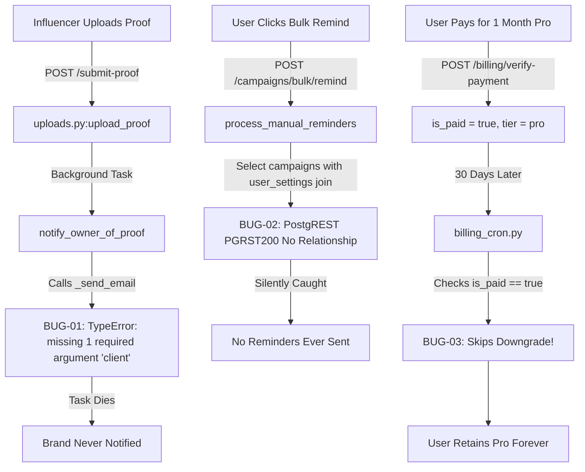

# Collabo Systems & QA Architectural Audit
**Scope:** Deep Audit for Logical Bugs, Race Conditions, Runtime Errors & State Synchronization  
**Date:** October 20, 2026  
**Auditor:** Staff Systems & QA Architect  

---

## Executive Summary

An end-to-end audit of the Collabo codebase was conducted across the Next.js frontend, FastAPI backend services, background workers (APScheduler / Redis), and Supabase PostgreSQL data layer. 

The audit identified **14 specific architectural and logical bugs**, categorized into **6 High Impact** (runtime crashes, data corruption, and infinite billing bypasses), **6 Medium Impact** (broken edge cases, state sync flaws, and timezone shifts), and **2 Low Impact** (obsolete route conflicts and API key omissions).

---

## 1. Bug Manifest

| Bug ID | Severity | Category | Short Title | Impact Area |
|---|---|---|---|---|
| **[BUG-01](#bug-01-missing-client-argument-in-_send_email-causes-runtime-crash)** | **High** | Runtime Crash | Missing `client` parameter in `_send_email()` | Influencer Proof Upload Workflow |
| **[BUG-02](#bug-02-non-existent-postgrest-embedded-join-in-process_manual_reminders)** | **High** | Runtime Crash | PostgREST join on un-related tables in `process_manual_reminders` | Campaign Reminders & Notifications |
| **[BUG-03](#bug-03-infinite-pro-access-for-300-via-is_paid-downgrade-bypass)** | **High** | Financial / Logic | Expired paid subscriptions are never downgraded | Monetization & Subscription Security |
| **[BUG-04](#bug-04-unvalidated-deadlines-cause-postgres-22007-crash-in-whatsapp-creation)** | **High** | Data Loss | Unvalidated string deadlines trigger Postgres syntax crash in WhatsApp bot | Chat / AI Extraction Lifecycle |
| **[BUG-05](#bug-05-asyncio-task-garbage-collection-drops-incoming-whatsapp-messages)** | **High** | Race Condition | Unreferenced `asyncio.create_task` leads to dropped webhook batches | WhatsApp Webhook Batching |
| **[BUG-06](#bug-06-webhook-vs-verify-payment-race-condition-blocks-plan-upgrade)** | **High** | Concurrency | Race condition between Razorpay Webhook & `verify-payment` | Checkout & Payment Verification |
| **[BUG-07](#bug-07-campaigns-due-today-flagged-as-overdue-due-to-utc-midnight-parsing)** | **Medium** | Date / Timezone | Campaigns due today are branded "LATE" throughout the day | Dashboard & Table Deadlines |
| **[BUG-08](#bug-08-whatsapp-created-campaigns-lack-short_code-breaking-tracking)** | **Medium** | Business Logic | Missing `short_code` generation on WhatsApp campaigns | Link Tracker & Click Analytics |
| **[BUG-09](#bug-09-free-tier-5-campaign-quota-bypass-via-whatsapp-bot)** | **Medium** | Quota / Security | Free accounts bypass 5-campaign limit via WhatsApp creation | Subscription Quotas |
| **[BUG-10](#bug-10-image-size-limit-discrepancy-between-frontend-and-backend)** | **Medium** | Validation | Upload proof frontend permits 10MB while backend rejects > 5MB | Magic Link Proof Submissions |
| **[BUG-11](#bug-11-monthly-reports-query-uses-utc-midnight-instead-of-ist-bounds)** | **Medium** | Reporting / Accounting | UTC month boundary shifts drop first-day-of-month campaigns in IST | Financial Reports (PDF/Excel) |
| **[BUG-12](#bug-12-dashboard-onrefresh-resets-data-without-resetting-page-counter)** | **Medium** | State Sync | Page counter desynchronizes on table refresh or inline mutations | Dashboard Infinite Scroll |
| **[BUG-13](#bug-13-obsolete-root-page-routes-shadow-dashboard-route-group)** | **Low** | Route Conflict | Old root pages (`app/calendar/`) conflict with `app/(dashboard)/*` | Next.js App Router |
| **[BUG-14](#bug-14-get-settingswhatsapp-exception-fallback-omits-username)** | **Low** | API Schema | Fallback dictionary in `get_settings()` missing `username` field | Settings Management |

---

## 2. Trace, Proof & Analysis



---

### BUG-01: Missing `client` Argument in `_send_email` Causes Runtime Crash

> [!CAUTION]
> **Severity:** High Impact (Breaks Core Notification Flow)  
> **Location:** [`influencertrack-backend/app/api/uploads.py#L84-L90`](file:///c:/Users/shahu/Desktop/collabo-part-2%20-%20Copy/influencertrack-backend/app/api/uploads.py#L84-L90)

#### Execution Trace
1. Influencer navigates to magic link `/submit-proof/[token]` and uploads proof file.
2. The file is uploaded to the Supabase storage bucket, and campaign status updates to `content_received`.
3. `notify_owner_of_proof` is added as a FastAPI `BackgroundTask`.
4. In [`uploads.py:89`](file:///c:/Users/shahu/Desktop/collabo-part-2%20-%20Copy/influencertrack-backend/app/api/uploads.py#L89):
   ```python
   if email_enabled:
       from app.services.reminders import _send_email, _get_user_email
       email = await _get_user_email(service_client, user_id)
       if email:
           subject = f"🎉 Proof Received for {inf_name}"
           html = get_proof_received_email_html(inf_name)
           await _send_email(email, subject, html)
   ```
5. In [`influencertrack-backend/app/services/reminders.py#L83`](file:///c:/Users/shahu/Desktop/collabo-part-2%20-%20Copy/influencertrack-backend/app/services/reminders.py#L83):
   ```python
   async def _send_email(to_email: str, subject: str, html: str, client: httpx.AsyncClient) -> bool:
   ```
6. **Failure:** Python raises `TypeError: _send_email() missing 1 required positional argument: 'client'`. The background task crashes, and the brand is never notified.

---

### BUG-02: Non-Existent PostgREST Embedded Join in `process_manual_reminders`

> [!CAUTION]
> **Severity:** High Impact (Broken Feature)  
> **Location:** [`influencertrack-backend/app/services/reminders.py#L636-L644`](file:///c:/Users/shahu/Desktop/collabo-part-2%20-%20Copy/influencertrack-backend/app/services/reminders.py#L636-L644)

#### Execution Trace
1. Brand owner selects multiple campaigns on the dashboard and triggers "Bulk Remind".
2. Endpoint `/campaigns/bulk/remind` enqueues [`process_manual_reminders`](file:///c:/Users/shahu/Desktop/collabo-part-2%20-%20Copy/influencertrack-backend/app/services/reminders.py#L629).
3. Query executed:
   ```python
   c_resp = await (supabase.table("campaigns")
       .select("*, user_settings(*)")
       .in_("id", campaign_ids)
       .execute()
   )
   ```
4. **Failure:** PostgREST cannot find a relationship between `campaigns` and `user_settings` because neither table contains a foreign key to the other (both independently reference `auth.users(id)`).
5. PostgREST returns `PGRST200`. The catch block catches the exception and returns early:
   ```python
   except Exception as exc:
       logger.error("reminders.manual_fetch_failed", error=str(exc))
       return
   ```
   Reminders fail 100% of the time. In addition, the notification logic at lines 660-671 queries the brand's own phone number and sends "Your campaign with the brand is pending action" to the brand instead of the influencer.

---

### BUG-03: Infinite Pro Access for ₹300 via `is_paid` Downgrade Bypass

> [!CAUTION]
> **Severity:** High Impact (Direct Financial Loss)  
> **Location:** [`influencertrack-backend/app/services/billing_cron.py#L57-L60`](file:///c:/Users/shahu/Desktop/collabo-part-2%20-%20Copy/influencertrack-backend/app/services/billing_cron.py#L57-L60) & [`influencertrack-backend/app/services/supabase.py#L91-L95`](file:///c:/Users/shahu/Desktop/collabo-part-2%20-%20Copy/influencertrack-backend/app/services/supabase.py#L91-L95)

#### Execution Trace
1. User pays ₹300 for 1 month of Pro.
2. In `verify_payment`, `subscriptions` is updated: `tier = 'pro'`, `is_paid = True`, `trial_ends_at = now + 30 days`.
3. 30 days later, the cron worker [`check_expired_trials_job`](file:///c:/Users/shahu/Desktop/collabo-part-2%20-%20Copy/influencertrack-backend/app/services/billing_cron.py#L16) runs:
   ```python
   # Line 58
   if is_paid or not trial_ends_at:
       log.info("billing_cron.skipping_paid_or_lifetime_user", ...)
       continue  # <-- Never downgrades!
   ```
4. Concurrently, [`is_user_pro_or_paid`](file:///c:/Users/shahu/Desktop/collabo-part-2%20-%20Copy/influencertrack-backend/app/services/supabase.py#L26) checks access:
   ```python
   # Line 93
   if is_paid and (has_valid_time or tier == "pro"):
       is_pro = True  # <-- Evaluates to True forever because tier == 'pro'
   ```
5. **Failure:** Paid users are never downgraded upon expiration and maintain full access indefinitely.

---

### BUG-04: Unvalidated Deadlines Cause Postgres `22007` Crash in WhatsApp Creation

> [!CAUTION]
> **Severity:** High Impact (Data Loss in Chat Workflow)  
> **Location:** [`influencertrack-backend/app/services/intent_executor.py#L70-L73`](file:///c:/Users/shahu/Desktop/collabo-part-2%20-%20Copy/influencertrack-backend/app/services/intent_executor.py#L70-L73)

#### Execution Trace
1. A user forwards a chat or sends: *"Book @creator for 15000, deadline tomorrow"*.
2. Gemini returns `IntentResponse` with `deadline = "tomorrow"`, `"15 Oct"`, or an unformatted date.
3. In [`intent_executor.py`](file:///c:/Users/shahu/Desktop/collabo-part-2%20-%20Copy/influencertrack-backend/app/services/intent_executor.py#L46-L71), raw campaign data is compiled and passed directly to Postgres:
   ```python
   db_inserts = [p["db_payload"] for p in payloads_to_insert]
   res = await supabase_admin.table("campaigns").insert(db_inserts).execute()
   ```
4. **Failure:** Supabase Postgres column `campaigns.deadline` has data type `DATE`. Non-ISO strings raise `22007 invalid input syntax for type date`. The entire batch fails, triggering line 219 (`"🤖 Oops! My servers hit a snag"`), and no campaign is saved.

---

### BUG-05: `asyncio` Task Garbage Collection Drops Incoming WhatsApp Messages

> [!CAUTION]
> **Severity:** High Impact (Silent Message Loss)  
> **Location:** [`influencertrack-backend/app/api/whatsapp.py#L597, L606`](file:///c:/Users/shahu/Desktop/collabo-part-2%20-%20Copy/influencertrack-backend/app/api/whatsapp.py#L597-L606)

#### Execution Trace
1. Meta sends incoming webhook requests to `POST /webhook/whatsapp`.
2. To batch rapid messages, the router acquires a lock and schedules a delayed processor:
   ```python
   if lock_acquired:
       asyncio.create_task(_process_batched_wrapper(sender_id))
   ```
3. Inside [`_process_batched_wrapper`](file:///c:/Users/shahu/Desktop/collabo-part-2%20-%20Copy/influencertrack-backend/app/api/whatsapp.py#L507):
   ```python
   await asyncio.sleep(3) # Wait window for batching
   ```
4. **Failure:** Per Python specification, `asyncio.create_task` only creates a weak reference. When the request completes, if Python's garbage collector runs during the 3-second sleep, the task is destroyed. The message batch is dropped without acknowledgment or execution.

---

### BUG-06: Webhook vs `verify-payment` Race Condition Blocks Plan Upgrade

> [!CAUTION]
> **Severity:** High Impact (Failed Payment State)  
> **Location:** [`influencertrack-backend/app/api/billing.py#L191-L245, L272-L311`](file:///c:/Users/shahu/Desktop/collabo-part-2%20-%20Copy/influencertrack-backend/app/api/billing.py#L191-L245)

#### Execution Trace
1. Razorpay fires the webhook `order.paid` simultaneously with the frontend checkout modal closing and invoking `POST /billing/verify-payment`.
2. Webhook handler [`process_razorpay_webhook_db`](file:///c:/Users/shahu/Desktop/collabo-part-2%20-%20Copy/influencertrack-backend/app/api/billing.py#L266) inserts into `processed_transactions`:
   ```python
   await service_client.table("processed_transactions").insert({"order_id": order_id, ...})
   ```
3. Before the webhook executes `subscriptions.update()`, `verify_payment` tries to insert the same `order_id` into `processed_transactions`.
4. It encounters a `duplicate key` error and enters the recovery block:
   ```python
   if existing_tx.data and existing_tx.data[0].get("user_id") == user.user.id:
       return {"status": "already_credited", "message": "Payment verified and already credited."}
   ```
5. **Failure:** If the webhook process fails on its subsequent query (e.g. transient timeout), `verify_payment` assumes the webhook completed and returns `already_credited`. The user's account is never upgraded, and retries are permanently rejected.

---

### BUG-07: Campaigns Due Today Flagged as Overdue Due to UTC Midnight Parsing

> [!WARNING]
> **Severity:** Medium Impact (Incorrect UI State & Premature Alarms)  
> **Location:** [`lib/api.ts#L373, L381`](file:///c:/Users/shahu/Desktop/collabo-part-2%20-%20Copy/lib/api.ts#L373-L381) & [`components/CampaignTable.tsx#L205`](file:///c:/Users/shahu/Desktop/collabo-part-2%20-%20Copy/components/CampaignTable.tsx#L205)

#### Execution Trace
1. A campaign has `deadline = "2026-10-20"`.
2. On October 20 at 10:00 AM local time, the user views their dashboard.
3. In [`lib/api.ts`](file:///c:/Users/shahu/Desktop/collabo-part-2%20-%20Copy/lib/api.ts#L373):
   ```ts
   const overdue = safeCampaigns.filter(c =>
     ['draft', 'active', 'needs_revision'].includes(c.status) &&
     c.deadline && new Date(c.deadline) < now
   );
   ```
4. **Failure:** `new Date("2026-10-20")` parses `"YYYY-MM-DD"` as UTC midnight (`2026-10-20T00:00:00.000Z`). In any local timezone ahead of UTC or anytime after 00:00 UTC, `new Date(c.deadline) < now` evaluates to **true**.
5. The campaign is marked with a red **LATE** badge on the morning of its due date, and dropped from `upcomingDeadlines`.

---

### BUG-08: WhatsApp-Created Campaigns Lack `short_code`, Breaking Tracking

> [!WARNING]
> **Severity:** Medium Impact (Analytics Feature Malfunction)  
> **Location:** [`influencertrack-backend/app/services/intent_executor.py#L56-L68`](file:///c:/Users/shahu/Desktop/collabo-part-2%20-%20Copy/influencertrack-backend/app/services/intent_executor.py#L56-L68)

#### Execution Trace
1. When a campaign is created via the web app in [`campaigns.py:200`](file:///c:/Users/shahu/Desktop/collabo-part-2%20-%20Copy/influencertrack-backend/app/api/campaigns.py#L200), a unique 8-character `short_code` is generated if `destination_url` is present.
2. When created via WhatsApp or Telegram in `intent_executor.py`, no short code is generated.
3. **Failure:** Campaigns created via WhatsApp have `short_code = null`. In the UI table, the click tracking badge and tracking link copy buttons display as disabled `—`.

---

### BUG-09: Free Tier 5-Campaign Quota Bypass via WhatsApp Bot

> [!WARNING]
> **Severity:** Medium Impact (Monetization Bypass)  
> **Location:** [`influencertrack-backend/app/api/whatsapp.py#L428`](file:///c:/Users/shahu/Desktop/collabo-part-2%20-%20Copy/influencertrack-backend/app/api/whatsapp.py#L428) vs [`campaigns.py#L207`](file:///c:/Users/shahu/Desktop/collabo-part-2%20-%20Copy/influencertrack-backend/app/api/campaigns.py#L207)

#### Execution Trace
1. The web API strictly enforces:
   ```python
   count_res = await client.table("campaigns").select("id", count="exact").eq("user_id", user.user.id).execute()
   if count_res.count is not None and count_res.count >= 5:
       raise HTTPException(status_code=403, detail="Free tier limit reached.")
   ```
2. The WhatsApp handler only checks `is_eligible, _ = await is_user_pro_or_paid(...)`. During a free trial, `is_eligible` is `True`.
3. `intent_executor.py` never checks total campaign count.
4. **Failure:** Any user on the free tier can create unlimited campaigns via WhatsApp, bypassing the 5-campaign paywall limit.

---

### BUG-10: Image Size Limit Discrepancy Between Frontend and Backend

> [!WARNING]
> **Severity:** Medium Impact (Confusing UX & 413 Errors)  
> **Location:** [`app/submit-proof/[token]/page.tsx#L48, L136`](file:///c:/Users/shahu/Desktop/collabo-part-2%20-%20Copy/app/submit-proof/%5Btoken%5D/page.tsx#L48) vs [`influencertrack-backend/app/api/uploads.py#L28`](file:///c:/Users/shahu/Desktop/collabo-part-2%20-%20Copy/influencertrack-backend/app/api/uploads.py#L28)

#### Execution Trace
1. The proof upload UI informs creators: `JPG, PNG (max 10MB) • MP4, MOV (max 50MB)`.
2. Client validation checks:
   ```ts
   if (selectedFile.type.startsWith('image/') && selectedFile.size > 10 * 1024 * 1024)
   ```
3. Backend [`uploads.py:28`](file:///c:/Users/shahu/Desktop/collabo-part-2%20-%20Copy/influencertrack-backend/app/api/uploads.py#L28) enforces:
   ```python
   MAX_IMAGE_SIZE = 5 * 1024 * 1024 # 5MB
   ```
4. **Failure:** A creator uploading an 8MB image passes client validation, but the server aborts with `HTTP 413: File size exceeds the limit (5MB)`.

---

### BUG-11: Monthly Reports Query Uses UTC Midnight Instead of IST Bounds

> [!WARNING]
> **Severity:** Medium Impact (Accounting Discrepancies)  
> **Location:** [`influencertrack-backend/app/services/reports.py#L28-L30, L52`](file:///c:/Users/shahu/Desktop/collabo-part-2%20-%20Copy/influencertrack-backend/app/services/reports.py#L28-L30)

#### Execution Trace
1. In `fetch_monthly_metrics`, the date filter runs:
   ```python
   .gte("created_at", f"{start_date}T00:00:00Z").lte("created_at", f"{end_date}T23:59:59Z")
   ```
2. In IST (UTC+5:30), the 1st of the month starts at `18:30:00Z` on the prior day.
3. In addition, line 52 aggregates pending values:
   ```python
   elif status in ["active", "content_received", "approved"]:
       pending_count += 1
       pending_value += amount
   ```
4. **Failure:**
   - Campaigns created on the 1st of the month between 00:00 and 05:30 IST are omitted from the report.
   - Campaigns in `needs_revision` are omitted from `pending_value`, causing reports to diverge from the dashboard metrics.

---

### BUG-12: Dashboard `onRefresh` Resets Data Without Resetting Page Counter

> [!WARNING]
> **Severity:** Medium Impact (Pagination Skipping)  
> **Location:** [`app/(dashboard)/dashboard/page.tsx#L101-L133`](file:///c:/Users/shahu/Desktop/collabo-part-2%20-%20Copy/app/%28dashboard%29/dashboard/page.tsx#L101-L133)

#### Execution Trace
1. User clicks "Load More", advancing `page` from 1 to 2.
2. The user edits a campaign or clicks "Refresh".
3. `onRefresh` calls `fetchCampaigns(true)` which defaults to `pageNum = 1`.
4. `setCampaigns` replaces state with page 1 items.
5. The `page` state is not reset to 1.
6. When the user subsequently clicks "Load More", `next = page + 1` evaluates to 3, skipping page 2 entirely.

---

### BUG-13: Obsolete Root Page Routes Shadow `(dashboard)` Route Group

> [!NOTE]
> **Severity:** Low Impact (Maintainability & Build Collision Risk)  
> **Location:** Root [`app/calendar/page.tsx`](file:///c:/Users/shahu/Desktop/collabo-part-2%20-%20Copy/app/calendar/page.tsx), [`app/billing/`](file:///c:/Users/shahu/Desktop/collabo-part-2%20-%20Copy/app/billing/), [`app/dashboard/`](file:///c:/Users/shahu/Desktop/collabo-part-2%20-%20Copy/app/dashboard/), etc.

#### Execution Trace
The workspace contains legacy files at the root of `app/` alongside the active `app/(dashboard)/*` route group.
In `app/calendar/page.tsx:24`, it executes `const campRes = await api.get<Campaign[]>('/campaigns/'); setCampaigns(campRes.data);`. Since `/campaigns/` returns `{ data: [...], count: 10 }`, calling `campaigns.filter(...)` throws `TypeError: campaigns.filter is not a function`.

---

### BUG-14: `GET /settings/whatsapp` Exception Fallback Omits `username`

> [!NOTE]
> **Severity:** Low Impact (API Schema Inconsistency)  
> **Location:** [`influencertrack-backend/app/api/settings.py#L178-L186`](file:///c:/Users/shahu/Desktop/collabo-part-2%20-%20Copy/influencertrack-backend/app/api/settings.py#L178-L186)

#### Execution Trace
If `client.table("user_settings").select(...)` throws a database exception, the fallback dictionary returned on lines 178-186 omits the key `"username": None`, while line 170 includes it.

---

## 3. Step-by-Step Remediation Plan

### Remediation 1: Proof Upload & Email Service (`uploads.py` & `reminders.py`)
- Make `client` optional with fallback in [`influencertrack-backend/app/services/reminders.py`](file:///c:/Users/shahu/Desktop/collabo-part-2%20-%20Copy/influencertrack-backend/app/services/reminders.py).
- Pass an explicit `client` instance in [`influencertrack-backend/app/api/uploads.py`](file:///c:/Users/shahu/Desktop/collabo-part-2%20-%20Copy/influencertrack-backend/app/api/uploads.py).

```diff
--- a/influencertrack-backend/app/services/reminders.py
+++ b/influencertrack-backend/app/services/reminders.py
@@ -83,1 +83,4 @@
-async def _send_email(to_email: str, subject: str, html: str, client: httpx.AsyncClient) -> bool:
+async def _send_email(to_email: str, subject: str, html: str, client: httpx.AsyncClient | None = None) -> bool:
+    if client is None:
+        async with httpx.AsyncClient(timeout=15.0) as local_client:
+            return await _send_email(to_email, subject, html, local_client)
```

```diff
--- a/influencertrack-backend/app/api/uploads.py
+++ b/influencertrack-backend/app/api/uploads.py
@@ -87,2 +87,4 @@
         if email:
             subject = f"🎉 Proof Received for {inf_name}"
             html = get_proof_received_email_html(inf_name)
-            await _send_email(email, subject, html)
+            import httpx
+            async with httpx.AsyncClient(timeout=15.0) as client:
+                await _send_email(email, subject, html, client=client)
```

---

### Remediation 2: Fix PostgREST Join in `process_manual_reminders` (`reminders.py`)
Replace the single embedded query with a two-step query matching the pattern used in `_fetch_campaigns_with_settings`.

```diff
--- a/influencertrack-backend/app/services/reminders.py
+++ b/influencertrack-backend/app/services/reminders.py
@@ -636,6 +636,17 @@
-        c_resp = await (supabase.table("campaigns")
-            .select("*, user_settings(*)")
-            .in_("id", campaign_ids)
-            .execute()
-        )
+        c_resp = await supabase.table("campaigns").select("*").in_("id", campaign_ids).execute()
+        campaigns = c_resp.data or []
+        if not campaigns:
+            return {"processed": 0}
+        user_ids = list({c["user_id"] for c in campaigns if c.get("user_id")})
+        settings_by_user = {}
+        if user_ids:
+            s_resp = await supabase.table("user_settings").select("*").in_("user_id", user_ids).execute()
+            for s in (s_resp.data or []):
+                settings_by_user[s["user_id"]] = s
+        for camp in campaigns:
+            camp["user_settings"] = settings_by_user.get(camp.get("user_id"), {})
```

---

### Remediation 3: Fix Billing Downgrade & Pro Calculation Logic
Enforce expiration on paid subscriptions when `trial_ends_at < now`.

```diff
--- a/influencertrack-backend/app/services/billing_cron.py
+++ b/influencertrack-backend/app/services/billing_cron.py
@@ -57,4 +57,3 @@
-            # CRITICAL: Never downgrade paid users or users with lifetime/unlimited pro
-            if is_paid or not trial_ends_at:
-                log.info("billing_cron.skipping_paid_or_lifetime_user", user_id=user_id, sub_id=sub_id, is_paid=is_paid)
+            # Only skip lifetime manual pro accounts (trial_ends_at is None)
+            if not trial_ends_at:
+                log.info("billing_cron.skipping_lifetime_user", user_id=user_id, sub_id=sub_id)
                 continue
@@ -64,1 +63,1 @@
-                await (supabase.table("subscriptions").update({"tier": "free"}).eq("id", sub_id).execute())
+                await (supabase.table("subscriptions").update({"tier": "free", "is_paid": False}).eq("id", sub_id).execute())
```

```diff
--- a/influencertrack-backend/app/services/supabase.py
+++ b/influencertrack-backend/app/services/supabase.py
@@ -91,7 +91,4 @@
     is_pro = False
-    # Rule 1: Paid account (active expiration or lifetime/manual pro)
-    if is_paid and (has_valid_time or tier == "pro"):
-        is_pro = True
-    # Rule 2: Tier is Pro (active paid or trial)
-    elif tier == "pro" and (is_paid or has_valid_time):
+    # Active if marked paid/pro AND within valid time window
+    if (is_paid or tier == "pro") and has_valid_time:
         is_pro = True
```

---

### Remediation 4: Normalize Deadlines & Generate Short Codes in `intent_executor.py`

```diff
--- a/influencertrack-backend/app/services/intent_executor.py
+++ b/influencertrack-backend/app/services/intent_executor.py
@@ -5,2 +5,3 @@
 from app.core.formatters import format_single_campaign_summary
+from app.core.parsers import parse_date_string
+import secrets, string
@@ -54,3 +55,10 @@
                 campaign_data["user_id"] = user_id
                 campaign_data["status"] = "draft"
                 campaign_data["influencer_handle"] = campaign_data.get("influencer_name") or "Unknown"
+                if campaign_data.get("deadline"):
+                    parsed_d = parse_date_string(str(campaign_data["deadline"]))
+                    campaign_data["deadline"] = parsed_d
+                if campaign_data.get("destination_url") and not campaign_data.get("short_code"):
+                    campaign_data["short_code"] = ''.join(secrets.choice(string.ascii_letters + string.digits) for _ in range(8))
```

---

### Remediation 5: Prevent Webhook Batch Garbage Collection (`whatsapp.py`)

```diff
--- a/influencertrack-backend/app/api/whatsapp.py
+++ b/influencertrack-backend/app/api/whatsapp.py
@@ -27,2 +27,3 @@
 _batch_locks = set()
+_running_batch_tasks = set()
@@ -596,2 +597,4 @@
                             if lock_acquired:
-                                asyncio.create_task(_process_batched_wrapper(sender_id))
+                                t = asyncio.create_task(_process_batched_wrapper(sender_id))
+                                _running_batch_tasks.add(t)
+                                t.add_done_callback(_running_batch_tasks.discard)
```

---

### Remediation 6: Safe Date Comparison Without UTC Midnight Shift

```diff
--- a/lib/api.ts
+++ b/lib/api.ts
@@ -358,3 +358,3 @@
-  const now = new Date();
+  const todayStr = new Date().toISOString().split('T')[0];
@@ -372,3 +372,3 @@
   const overdue = safeCampaigns.filter(c =>
     ['draft', 'active', 'needs_revision'].includes(c.status) &&
-    c.deadline && new Date(c.deadline) < now
+    c.deadline && c.deadline < todayStr
   );
@@ -380,3 +380,3 @@
-      const d = new Date(c.deadline);
-      return d >= now && d <= sevenDaysLater;
+      return c.deadline >= todayStr && new Date(c.deadline) <= sevenDaysLater;
```

---

### Remediation 7: Align Proof Upload Image Limits
Update [`app/submit-proof/[token]/page.tsx`](file:///c:/Users/shahu/Desktop/collabo-part-2%20-%20Copy/app/submit-proof/%5Btoken%5D/page.tsx) validation from 10MB to 5MB (or update [`uploads.py:28`](file:///c:/Users/shahu/Desktop/collabo-part-2%20-%20Copy/influencertrack-backend/app/api/uploads.py#L28) `MAX_IMAGE_SIZE` to 10MB) to ensure parity.

---

### Remediation 8: Dashboard Page State Reset on Refresh

```diff
--- a/app/(dashboard)/dashboard/page.tsx
+++ b/app/(dashboard)/dashboard/page.tsx
@@ -101,3 +101,4 @@
   const fetchCampaigns = useCallback(async (silent = false, pageNum = 1) => {
+    if (pageNum === 1) setPage(1);
     if (!silent && pageNum === 1) setIsLoading(true);
```

---

## 4. Verification & Testing Matrix

| Test ID | Objective | Verification Command / Step | Expected Result |
|---|---|---|---|
| **TEST-01** | Verify Proof Upload Email | Submit a test proof via `/submit-proof/[token]` with email reminders active | `notify_owner_of_proof` completes successfully with HTTP 200 without `TypeError` |
| **TEST-02** | Verify Bulk Reminders | Invoke `POST /campaigns/bulk/remind` with valid campaign IDs | Reminders process without PostgREST relationship errors |
| **TEST-03** | Verify Paid Downgrade | Set test subscription `is_paid = true`, `trial_ends_at = now - 1 day`, trigger billing cron | User is downgraded to `free` and `is_paid = false` |
| **TEST-04** | Verify Natural Date Creation | Send WhatsApp message with date `"next Friday"` | Date parses to `YYYY-MM-DD` and inserts into Postgres without `22007` |
| **TEST-05** | Verify Deadline Display | View active campaign due today on Dashboard | Campaign displays as active without premature `LATE` badge |

---

*Report generated and archived for system review.*
